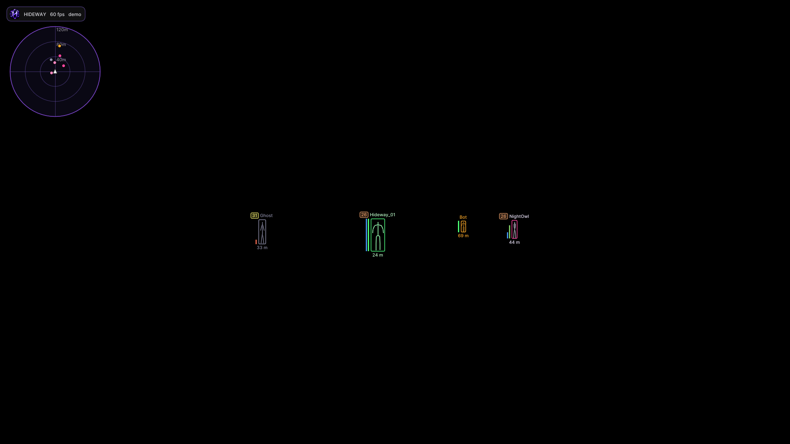

# Demo mode

Demo mode shows the whole interface with **synthetic players**. It needs no license, no DMA card and no game, and it never drives your input device.

## Start it

Run the game module with `--demo`:

```bash
Hideway.exe --demo
```

(Inside the package this is `core\Hideway.exe`.) You can also start the launcher with `--demo` to look at the launcher without signing in.

Demo mode is marked **DEMO** everywhere: the top bar, the license line, the preview card.

## What it is good for

* Learning the menu before your hardware arrives.
* Trying a preset or a colour scheme.
* Checking what the Team ID, health bars, squad list and radar look like.
* Taking screenshots for a bug report.

## What it is not

* It is **not** a real match. Positions, teams, names and health are generated. Nothing here says anything about how the program behaves in a real game.
* Debug rows that need the game (DMA, world, camera) say so instead of showing fake numbers.


In demo mode your configs are kept next to the program instead of in your user profile, so experiments never touch your real configs.


<figure><figcaption><p>Demo overlay: Team ID badges (26, 31), health and shield bars, skeletons, bot in orange, radar in the corner.</p></figcaption></figure>
