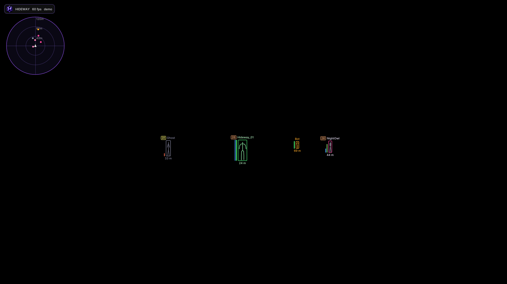

# Set up the ESP

A good ESP is clear, steady and in the right place. This guide walks the options in the order that matters.

## 1. Start from a preset

**Config > PRESETS** gives four starting points. A preset only changes what it lists, so your other settings stay.

| Preset | What it gives you |
|---|---|
| **ESP only** | Boxes, skeletons, names, health, radar. Aim is off |
| **Clean visuals** | Corner boxes, name, distance and health bars only |
| **Full visuals** | Everything on: gradients, glow, all text, lines, radar |
| **Subtle aim assist** | Narrow field of view, slow random smoothing, visible only |

Save your own config first if you do not want to lose what you have (Auto-save keeps backups, see [Configs](configs.md)).

## 2. Choose what to draw

On **Visuals**, rest the cursor on any row for a one-line explanation.

* **Box style**: *Box*, *Corners* (cleaner in crowds) or *3D box*.
* **Skeleton**: thin lines are readable at distance. **Distance-scaled lines** keep far players from cluttering.
* **Health + shield bars**: see [Health and shield bars](../troubleshooting/health-and-data.md). If the game sends no value, no bar is drawn.
* **Team ID**: the game's own team number before the name. Turn on **Team ID colours** to tell squads apart in a crowd.
* **Squad list** and **Match info**: a panel of other squads, and players / teams left at the top.
* **Max ESP players** and **Render distance** cap the load in big lobbies.


In a crowded match, turn on **Distance detail (LOD)** (Visuals > TARGET + DETAIL): far players are drawn with thinner lines and fewer extras. It is cleaner and cheaper to draw.


## 3. Make it smooth

On **Misc**:

| Option | Use |
|---|---|
| **Smooth ESP** (default on) | Boxes glide between data updates instead of stepping |
| **ESP smoothness** | *Responsive* / *Balanced* (default) / *Silky*. Silky absorbs corrections slowly: about a third less jitter in measured recordings, boxes a few cm from raw readings |
| **Smooth skeleton** | Limbs stop jittering when the root position steps with network updates |
| **Motion estimator** | One motion model per player shared by ESP and aim lead; follows strafes and stops closely |
| **VSync** | Match your display's refresh rate |

## 4. Put it in the right place

If boxes **trail** the players, raise **ESP time offset** (Misc) by a few milliseconds. If they **lead**, lower it. The default is 0. Make sure the game runs **borderless or full-screen** on the same monitor you capture.

## 5. Keep it readable

* **Fade in players**: a player entering view fades in over a moment instead of popping.
* **Avoid overlapping labels**: names and team numbers of close players are lifted apart.
* **Hide knocked players** if downed players clutter the screen.

<figure><figcaption>
Demo: Team ID badges, segmented bars, skeletons, bot in orange.
</figcaption></figure>

## 6. Check the load

Open **Debug > PERFORMANCE** (turn Debug on in Misc). *Tick* should be well below 10 ms and *Data age* below about 20 ms. High values point at the DMA link (cable, USB port, other USB traffic) more than the overlay. See [ESP quality](../troubleshooting/esp-quality.md).
