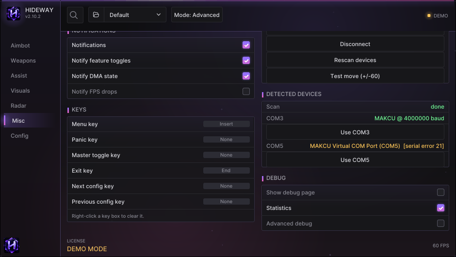

# Connect an input device

Aim and trigger move and click the mouse **through a hardware input device**. Nothing moves the mouse until you enable an aim feature and the device is connected.

## Supported devices

| Device | Link | Notes |
|---|---|---|
| **KMBox NET** | Network (UDP): IP, port and an 8-character UUID shown on the device screen | The overlay PC must be on the same subnet. A device is "connected" only when it echoes the handshake |
| **MAKCU** | USB serial (CH343 driver), 4 Mbaud first | Appears as a COM port. If Windows shows an extra "virtual COM port" that does not answer, pick the other one |
| **Ferrum** | USB serial | Follows the vendor's documented command set. Treat it as less proven than the other two |

## Connect it

1. **Misc > INPUT DEVICE**: tick **Enable input device**.
2. **Device type**: *Auto-detect* finds a MAKCU or Ferrum on a serial port; choose *KMBox NET* to connect over the network.
3. **Serial devices**: leave **Serial port** empty to auto-detect, or type it (for example `COM3`). **Baud rate**: *Auto* probes the usual rates.
4. **KMBox NET**: fill **Kmbox IP**, **Kmbox port**, **Kmbox UUID**.
5. Press **Connect**. The top bar shows the real device state.
6. Press **Test move (+/-60)**: it sends one small movement so you can see it works.

<figure><figcaption>
INPUT DEVICE, DETECTED DEVICES: ports found, and which one answered.
</figcaption></figure>

## "Connected" really means connected

A device counts as connected only when it **answered**: a KMBox NET echoed the handshake (and keeps acknowledging), a serial device answered its version query. A port that merely exists is shown as an error ("port opened but the device did not answer"). If the link is lost, **Auto reconnect** retries at 2, 4, 8, then 10 seconds, and finds a re-plugged device again even if Windows gave it another COM number.

## DETECTED DEVICES

Lists the serial ports Hideway found and which ones look like input devices. Only candidate ports are probed (vendor 1A86 / CH34x / CH343, or a name containing MAKCU, Ferrum, KMBox); other serial devices are never opened. **Rescan devices** looks again.

## Missing driver (MAKCU)

A MAKCU needs the WCH **CH343** driver. If it is missing, Windows shows a device problem code (for example 28 = no driver) and the connect error says so. Open the WCH download page from Hideway's setup buttons, download `CH343SER` yourself, then Hideway checks that the installer is signed by "Nanjing Qinheng Microelectronics" before offering to run it. Replug the device afterwards.

## Read game-PC mouse buttons

With **Read game-PC mouse buttons** (Misc > ENGINE) the input device reports the mouse buttons of the **game PC**, so the aim and trigger keys work from the mouse you are actually holding, not only from the overlay PC. Hideway's own clicks are ignored.

## Safety behaviour

* A held mouse button is **released** on disconnect, link loss, shutdown and even if Hideway crashes.
* The trigger never fires while the menu is open or panic is active (**Trigger pause in menu**).

## Not working?

| Symptom | Try |
|---|---|
| Not found | Replug; check Device Manager for a COM port; install the CH343 driver |
| "busy - another program has it open" | Close other tools that hold the port |
| Connected but aim does nothing | Press **Test move**; tune **Counts per degree X / Y** on the Aimbot page ([Tune aim and trigger](aim-and-trigger.md)) |
| Link keeps dropping | Use a different cable / port; keep **Auto reconnect** on |

More in [Aim or trigger problems](../troubleshooting/aim-and-trigger.md).
