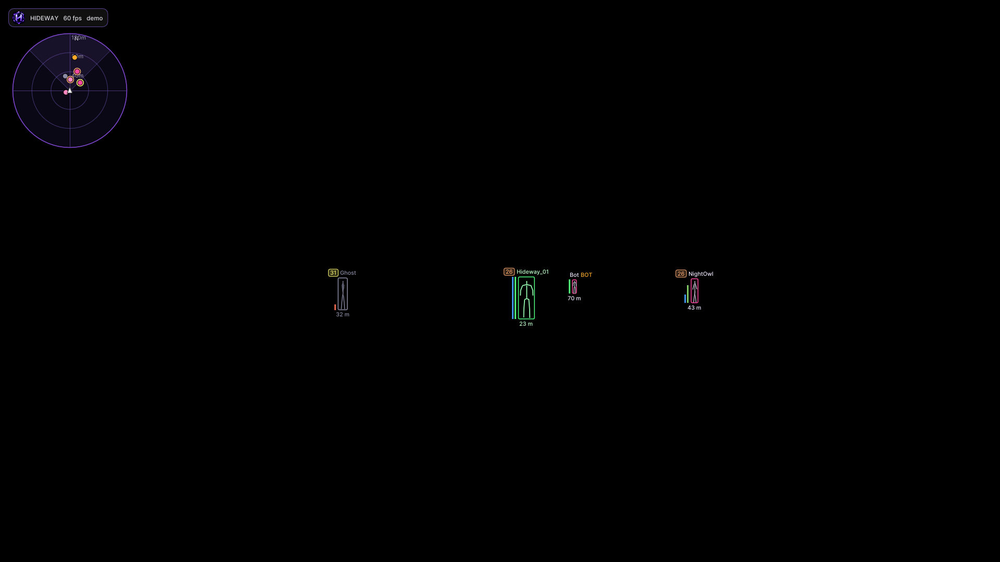

# Hideway

<figure><figcaption></figcaption></figure>

Hideway draws ESP and a radar on top of Fortnite, and can move your mouse for aim assist and fire for you. It runs on a second PC and reads the game through a DMA card, so nothing is installed or started on the PC that runs Fortnite.

This handbook is written for people who bought it and want it working. It tells you what to plug in, what to click, what each setting does, and what to do when something looks wrong.

<figure><figcaption>
The overlay in demo mode. The players are generated, so you can look at every option without a game.
</figcaption></figure>

## Start here

1. [Before you start](getting-started/requirements.md): the two PCs, the card, the license.
2. [Install and first launch](getting-started/install-and-first-start.md): about ten minutes.
3. [Is everything connected?](getting-started/ready-check.md): the green / orange / red check.
4. [Set up the ESP](guides/esp-setup.md) and, if you use it, [aim assist](guides/aim-and-trigger.md).

If something is already wrong, open the [quick checklist](troubleshooting/quick-checklist.md).

## The short version

| | |
|---|---|
| Game | Fortnite. This release carries the data for build 43.10 |
| Hardware | A DMA card in the game PC, a second PC for Hideway. Optional: a MAKCU, Ferrum or KMBox NET for aim and trigger |
| Windows | 10 or 11, 64-bit, administrator rights on the overlay PC |
| Open the menu | **Insert**. **End** closes Hideway |
| Updates | Through the launcher. A version that fails to start is rolled back for you |
| Help | [Collect diagnostics](troubleshooting/collecting-diagnostics.md) and send them with a short description |

