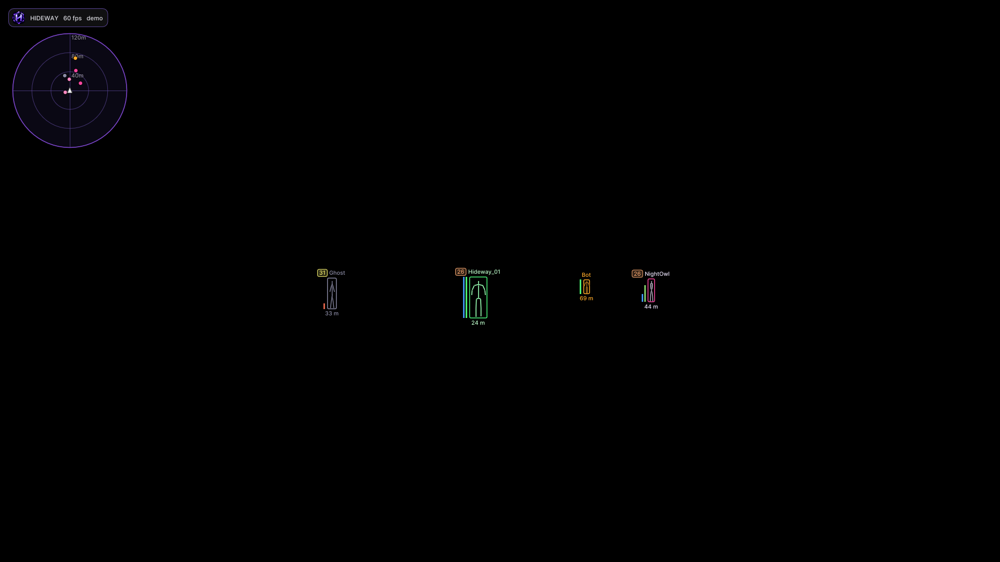

# Hideway handbook

<figure><figcaption></figcaption></figure>

**Hideway** is a Fortnite overlay for DMA setups. It runs on a second PC (the **overlay PC**), reads the game from the **game PC** through your DMA card (read-only), and draws ESP, radar and optional aim assist on a transparent window. Nothing runs inside the game PC.

This handbook is the one place for everything: how to install and start it, what every page of the menu does, how to set things up well, and how to fix the problems people actually run into.


**New here?** Read [What you need](getting-started/requirements.md), then [Install and first start](getting-started/install-and-first-start.md). You will be up in about ten minutes. If something is red, go to [Quick checklist](troubleshooting/quick-checklist.md).


<figure><figcaption>
The overlay in demo mode: boxes, skeletons, Team ID badges, health bars, radar. (Synthetic players, not a real match.)
</figcaption></figure>

## Where to go



1. [What you need](getting-started/requirements.md)
2. [Install and first start](getting-started/install-and-first-start.md)
3. [The launcher](getting-started/the-launcher.md)
4. [READY CHECK: is everything connected?](getting-started/ready-check.md)
5. [Try it without hardware: demo mode](getting-started/demo-mode.md)



1. [Menu overview](the-menu/overview.md)
2. [Set up the ESP](guides/esp-setup.md)
3. [Connect an input device](guides/input-device.md)
4. [Tune aim and trigger](guides/aim-and-trigger.md)
5. [Configs: presets, auto-save, backups](guides/configs.md)
6. [Web radar on your phone](guides/web-radar.md)



1. [Quick checklist](troubleshooting/quick-checklist.md)
2. [No ESP](troubleshooting/no-esp.md)
3. [Aim or trigger problems](troubleshooting/aim-and-trigger.md)
4. [The game closes or crashes](troubleshooting/game-closes-or-crashes.md)
5. [Collect diagnostics for support](troubleshooting/collecting-diagnostics.md)
6. [FAQ](faq.md)



## At a glance

| | |
|---|---|
| **Game** | Fortnite (offsets in this release are for build 43.00) |
| **Hardware** | A DMA card in the game PC, a second PC to run Hideway. Optional input device (MAKCU, Ferrum or KMBox NET) for aim and trigger |
| **System** | Windows 10 / 11, 64-bit, administrator rights on the overlay PC |
| **Menu key** | **Insert** (change it in Misc). **End** exits |
| **Menu** | One all-in-one menu: every option is on its page, with search to find any of them |
| **Updates** | Signed releases through the launcher. A bad update rolls back by itself |
| **Support** | Copy diagnostics (Debug page) and the log file; see [Collect diagnostics](troubleshooting/collecting-diagnostics.md) |

## What is verified and what is not

This handbook says plainly what has been seen working in real matches and what has only been tested offline. The short version is on one page: [Known limits and what is verified](reference/known-limits.md). When a feature is marked *unverified*, treat it as a test, not a promise.

