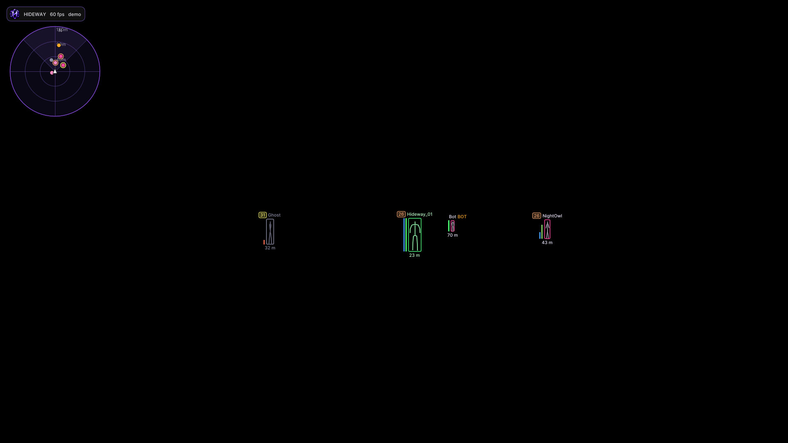

# Demo mode

Demo mode runs the whole interface with generated players. It needs no license, no card and no game, and it never drives your input device.

## Start it

Run the game module with `--demo`:

```bash
Hideway.exe --demo
```

Inside the package that file is `core\Hideway.exe`. You can also start the launcher with `--demo` to look at it without signing in. Everything is marked **DEMO**: the top bar, the license line and the preview card.

## What it is good for

* Learning the menu before your hardware arrives.
* Trying a preset or a colour scheme.
* Seeing what Team ID, health bars, the squad list and the radar look like.
* Taking screenshots.

## What it is not

It is not a real match. Positions, teams, names and health are made up, so it says nothing about how Hideway behaves in a game. Debug rows that need the game say so instead of showing fake numbers.

In demo mode your configs stay next to the program instead of in your user profile, so nothing you try touches your real configs.

<figure><figcaption><p>Demo overlay: Team ID badges (26, 31), health and shield bars, skeletons, a bot with its BOT tag, radar in the corner.</p></figcaption></figure>
