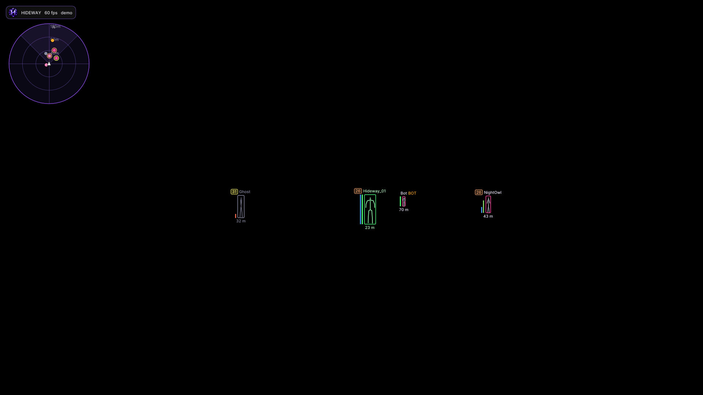

# Set up the ESP

A good ESP is easy to read, steady, and in the right place on the screen. Go through this once and you will rarely need to touch it again.

## 1. Start from a preset

**Config > Presets** has five starting points. A preset only changes the options it lists, so everything else stays as you had it.

| Preset | What you get |
|---|---|
| ESP only | Boxes, skeletons, names, health, radar. Aim off |
| Clean visuals | Corner boxes, name, distance and health bars |
| Full visuals | Everything on: gradients, glow, all text, lines, radar |
| Radar only | The radar on; ESP, loot, aim and trigger off |
| Subtle aim assist | Aim on with a 35 deg field of view, slow smoothing (22), chest aim, Humanizing on, visible targets only |

If you already have settings you like, save them as a config first. Auto-save keeps backups too, see [Configs](configs.md).

## 2. Choose what to draw

All of this is on **Visuals**. Hold the cursor on a row for its explanation.

* **Box style**: Box, Corners (cleaner in a crowd) or 3D box.
* **Skeleton**: thin lines read well at distance. **Distance-scaled lines** keep far players from cluttering the screen.
* **Health + shield bars**: you will only see them where the game sends the value, which in practice means you and your squad. See [Health and shield bars](../troubleshooting/health-and-data.md).
* **Team ID**: the game's own team number in front of the name. Each team number gets its own colour (automatic), which helps in a crowd, and the number only shows on real teams.
* **Squad list** and **Match info**: a panel with the other squads, and the players and teams left.
* **Max ESP players** and **Render distance** limit the load in big lobbies.
* **Show bots** and **Show teammates** are separate switches. Bots get the same colours as other players (pink hidden, green visible) plus a small BOT tag next to the name.

In a crowded match, turn on **Distance detail (LOD)**: far players get thinner lines and fewer extras.

## 3. Colours: what you are looking at

* Pink: the player is not visible to you.
* Green: the player is visible.
* Blue: a teammate.
* Grey: a knocked player.
* Yellow: the player your aim or trigger has picked (**Highlight target**).

All of these can be changed under **Visuals > Colors**.

## 4. Smoothness

The smoothing is automatic, there is nothing to set: **Smooth ESP** (boxes glide between data updates instead of stepping), **ESP smoothness** *Balanced* and the **Motion estimator** (one motion model per player, shared by the ESP and the aim lead) are always on and not in the menu. See [Automatic settings](../reference/options.md#automatic-settings-not-in-the-menu). The one choice that is yours is **VSync** on **Misc**: match it to your display.

## 5. Put it in the right place

The boxes are drawn for the moment the frame is shown (the time offset is automatic and fixed at 0). Run the game borderless or full screen on the monitor you actually capture. If the boxes seem to run ahead of the image on a fuser, that is the capture card's delay: see [Boxes lag or run ahead](../troubleshooting/esp-quality.md).

## 6. Keep it readable

* **Fade in players**: a player entering view fades in instead of popping.
* Names and team numbers of nearby players, and the labels of loot, chests and vehicles, are moved apart automatically.
* **Hide knocked players**, if downed players clutter the screen.

<figure><figcaption>
Demo: Team ID badges, bars, skeletons, a bot with its BOT tag.
</figcaption></figure>

## 7. Check the load

Open **Debug > Performance**. *Tick* should be well under 10 ms and *Data age* under about 20 ms. High numbers usually point at the DMA link (cable, USB port, other USB traffic) rather than the overlay. See [ESP looks wrong](../troubleshooting/esp-quality.md).
