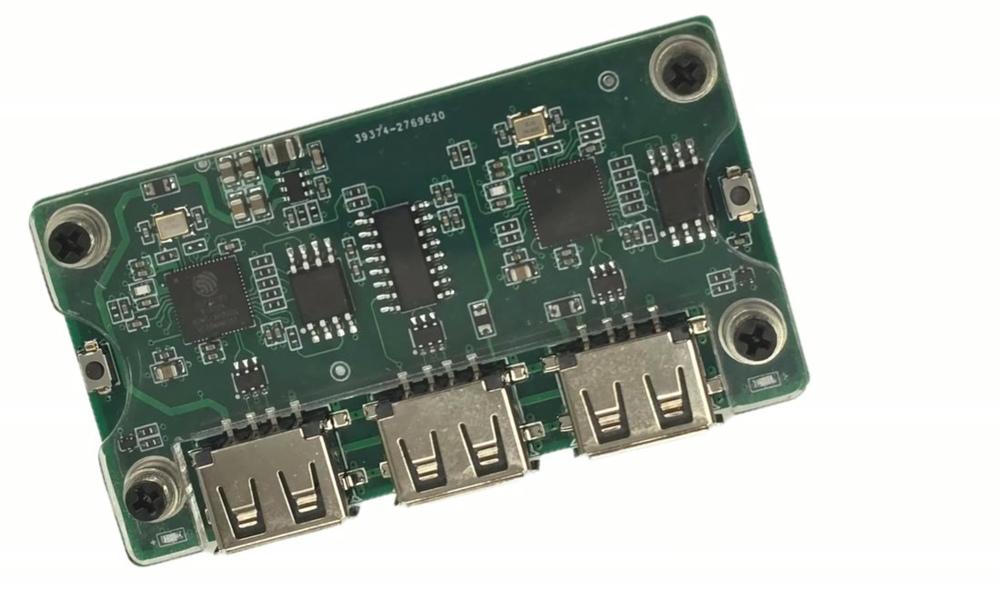

# Input devices

An **input device** is a small hardware box that sits between your mouse and your PCs. Hideway tells it to move or click, and the game PC only ever sees normal mouse input. It is needed **only for aim and trigger**; ESP, radar and the HUD work without one.

This page covers the hardware. The software side (the Misc page, auto-detect, test move) is in [Connect an input device](../guides/input-device.md).

## What Hideway supports

| Device | Link | Notes |
|---|---|---|
| **MAKCU** | USB serial (CH343 chip) | The most common choice. Passes your real mouse through |
| **Ferrum** | USB serial | Follows the manufacturer's documented commands; the least proven of the three here |
| **KMBox NET** | Network (UDP) | IP, port and UUID shown on the device |

Other devices that exist on the market (Arduino-based boxes, older KMBox models, legacy kits) are **not supported by Hideway**.

## Pass-through

With **pass-through** the device forwards your real mouse to the game PC and only adds its own movement on top. The mouse keeps working normally, and mouse software such as Logitech G Hub or Razer Synapse keeps recognising the mouse, so DPI and profiles still work. Without pass-through the device is a separate virtual mouse.

## MAKCU: wiring

```
                 +--------------------+
   Game PC  <----| LEFT   MIDDLE RIGHT|
                 |   |      |      |  |
                 +---|------|------|--+
                     |      |      |
                 game PC  overlay  your
                 (USB)     PC      mouse
```

| Cable | Goes to |
|---|---|
| **Left** | The **game PC** (the device presents itself there as a mouse) |
| **Middle** | The **overlay PC** (Hideway talks to it here, as a COM port) |
| **Right** | Your **real mouse** |

Labels can differ between revisions: check the silk-screen on your board and the manual that came with it.

<figure><figcaption><p>The MAKCU board. The three USB ports, from left to right: game PC, overlay PC, your mouse.</p></figcaption></figure>

## MAKCU: driver

On the overlay PC the MAKCU appears as a **serial (COM) port** and needs the WCH **CH343** driver: [Download the CH343 driver (official WCH page)](https://www.wch-ic.com/downloads/CH343SER_EXE.html). If Windows shows a problem code (28 means no driver), install it; Hideway can also open the WCH download page for you and checks the installer's publisher before offering to run it. See [Missing driver](../guides/input-device.md#missing-driver-makcu).

Some tools want a low COM number. In Device Manager > Ports (COM & LPT) > your port > Port Settings > Advanced you can set the number below 10. Hideway does not need this: it finds the device again even if Windows gives it a new number.

## MAKCU: firmware

Flash only if our team tells you to, and do it from the **overlay PC** (the flashing tool unpacks temporary files where it runs).

1. Download the MAKCU flashing tool and let it update itself.
2. Hold the **LEFT** button on the board, then plug the USB cable into the **LEFT** port. The tool should say it sees the MCU **in flash mode**.
3. Press **Flash Left**, wait for it to finish, then unplug.
4. Repeat with the **RIGHT** button and **RIGHT** port, **Flash Right**.
5. Reconnect the three cables as in the wiring above, restart the tool and run its **TEST**: the cursor on the game PC should move.

## Check it in Hideway

**Misc > INPUT DEVICE > Enable input device > Connect > Test move (+/-60)**. The top bar shows the real device state. If it does not connect, see [Not working?](../guides/input-device.md#not-working).

## Without a controller (mouse and keyboard)

This is the standard setup: wire the MAKCU as in **MAKCU: wiring** above (left to the game PC, middle to the overlay PC, right to your real mouse), install the CH343 driver, then connect it in Hideway (**Misc > INPUT DEVICE**).

## With a controller: XIM Matrix and MAKCU

If you play with a gamepad and want the game to see mouse input, a **XIM Matrix** translates the controller into mouse and keyboard, and the MAKCU is wired behind it. The general flow:

1. Pair the controller with the XIM Matrix (wired to its controller port, or wirelessly). Xbox pads: hold the sync button until the guide button flashes fast. PlayStation pads: hold **Share** then **PS** until the light flashes quickly.
2. On the game PC install the XIM manager software, connect the XIM Matrix and create a new config: pick the game and PC, input **Gamepad**, output **Mouse and keyboard**.
3. Connect the MAKCU as in the wiring above, with the XIM Matrix on the cable shown in the wiring diagram of your revision.
4. In the game set the input to mouse and keyboard.

Follow the wiring picture for your exact revision; the Hideway side stays the same (Misc > INPUT DEVICE).

## Safety behaviour

A held button is released on disconnect, link loss, shutdown and if Hideway crashes. The trigger never fires while the menu is open or panic is active.
