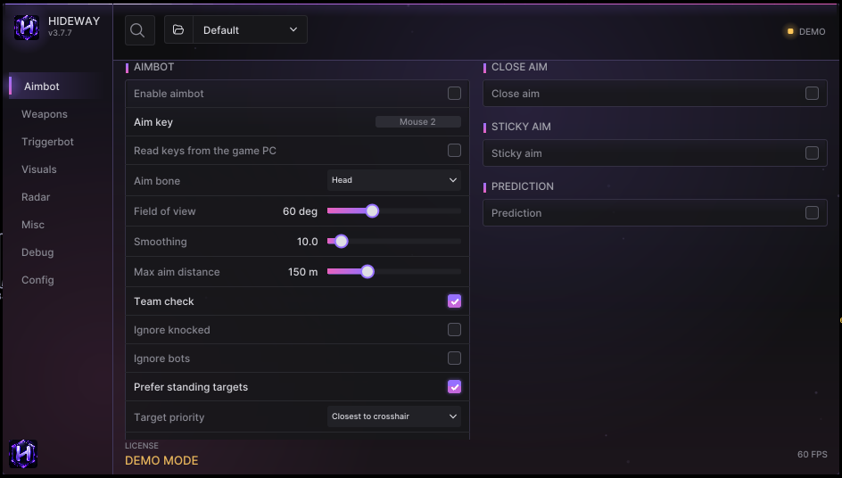
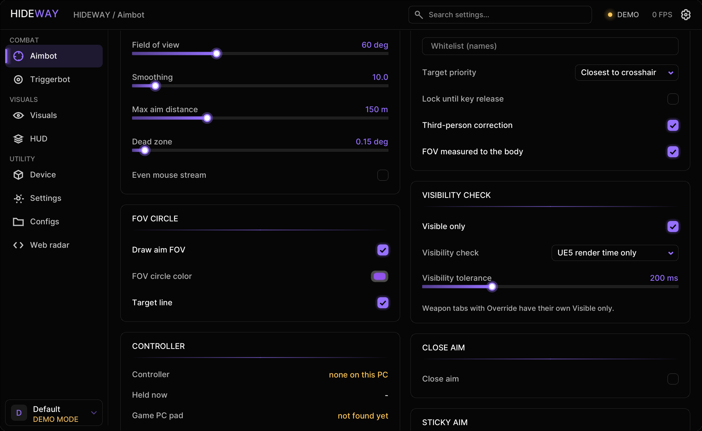

# Aimbot

*Since 3.8.0 the menu is laid out like this: the **Aimbot** page has the AIMBOT, FOV CIRCLE, CONTROLLER and HUMANIZING cards on the left and TARGETS, VISIBILITY CHECK (since 3.8.4), CLOSE AIM, STICKY AIM and PREDICTION on the right, under a row of weapon tabs (Global, Rifle, Pistol, SMG, Shotgun, Sniper). The **HUMANIZING** card is at the bottom of the left column (it had its own page in 3.8.0 and 3.8.1).*

This page controls aim assist, close aim, sticky aim and prediction. Aim assist moves your mouse through the **input device**, so it does nothing until a device is connected. See [Connect an input device](../guides/input-device.md). For a walk-through of the settings in a sensible order, read [Tune aim and trigger](../guides/aim-and-trigger.md).

<figure><figcaption>
The Global tab of the Aimbot page: the AIMBOT card on the left, TARGETS and the start of VISIBILITY CHECK on the right. The tabs on top are the weapon classes.
</figcaption></figure>

<figure><figcaption>
Scrolled down: the CONTROLLER card and HUMANIZING at the bottom of the left column.
</figcaption></figure>

## AIMBOT

| Option | What it does |
|---|---|
| Enable aimbot | Master switch. Needs a connected input device |
| Aim key | Hold it to aim. Click the box and press a key, a mouse button or a controller button; click it again to pick Mouse 1; right-click to clear. Default Mouse 2 |
| Read keys from the game PC | Also reads the keyboard and mouse of the game PC through the DMA card, so the aim key (and the trigger key) can be any key of the game PC's own keyboard. Off by default. The log (KEYS) says whether the key table of the game PC's Windows was found; if it reports many keys held at once it switches itself off for 5 minutes |
| Aim bone | Head, Neck, Chest or Pelvis aim at that part (the head a little above its joint, where the game counts a head hit). **Closest bone** aims at the point of the body nearest to your crosshair, between the joints. If the chosen part is behind a wall, the aim uses the nearest exposed part instead |
| Field of view | Only targets inside this cone around the crosshair count (measured to the chosen part: up close the head sits far above the chest, so a small field of view may not engage there; use **Close aim**, a bigger field of view or **Closest bone**). Smaller is more selective |
| Smoothing | How slowly the aim closes the gap. 1 is instant. Each step adds about 8 ms to the time it takes to get there |
| Max aim distance | Targets further than this are ignored |
| Team check | Never aim at teammates |
| Ignore knocked | Skip downed players |
| Ignore bots | Skip bots |
| Prefer standing targets | Standing players are picked before downed ones |
| Target priority | Closest to the crosshair, closest in distance, or **Smart**: anybody inside 60 m first, then the rest |
| Third-person correction | On by default. The camera swings round your player, so a target near you needs a bigger turn than the angle it is seen at (about 1.4x at 5 m, 1.2x at 10 m, 1.07x at 30 m); this adds it, so close fights lock on faster. Hideway measures how rigidly your camera orbits and switches itself off in first person or scoped. Off = plain angles |
| Lock until key release | Stay on the first target until you let go of the aim key |
| Dead zone | Inside this angle the aim stops moving, so it does not shake |

<figure><figcaption>
A little further down: FOV CIRCLE on the left, the VISIBILITY CHECK card on the right (Visible only, the method and the tolerance).
</figcaption></figure>

## VISIBILITY CHECK

*Back in the menu since 3.8.4 (it was automatic from 3.3 to 3.8.3, with the same defaults).* Under TARGETS on the right.

| Option | What it does |
|---|---|
| Visible only | On by default. The aim only goes for players the game is drawing on screen and never through a wall the game's crosshair trace shows. Off = it also locks players behind walls |
| Visibility check | How visible is judged: **UE5 render time only** (default, the game's own check, works from the first second), **Unreal line of sight** or **Bones (head, chest, knee)** (rays against the level, ready a few seconds into a match). See [Visibility](../guides/visibility.md) |
| Visibility tolerance | A player counts as visible if the game drew them within this many milliseconds (default 200). Lower = stricter behind cover, higher = steadier |
| Wait for wall check | Only with one of the two ray methods: the aim waits until the level is read instead of trusting the render time alone |

A weapon tab with **Override** on uses its own **Visible only** (on by default since 3.8.4; older configs get it switched on once).

## CONTROLLER

Shows the controllers Windows sees on **this** PC and the buttons held right now, whether the **game PC's own input table** can be read (a controller that is only plugged into the game PC: Ferrum or MAKCU, no XIM) and what the game says about aiming down sights.

| Option | What it does |
|---|---|
| Trigger pull | How far LT / RT must be pressed to count as held, when a trigger is your Aim key or Trigger key |
| Aim activation | **Aim key**, **Aiming down sights** or **Key or aiming down sights**. With the second one the aim follows what the game says (you hold LT / right mouse), whatever the controller is |

## FOV CIRCLE and HUMANIZING

* **FOV circle** draws the aim cone and lets you pick its colour. **Target line** draws a line to the current target.
* **Humanizing** is one switch. On, the aim behaves a little like a hand: a short reaction time (45 ms), a pause before it switches to another target (150 ms), a little shake, a very rare small miss (3 %), a soft landing, a cap on every step (30 counts) and a slower follow on close targets. Off, none of it. The eleven values behind the switch are listed under [Automatic settings](../reference/options.md#automatic-settings-not-in-the-menu).

## Close aim, sticky aim, prediction

* **Close aim** uses its own field of view, smoothing and bone for enemies within a short range.
* **Sticky aim** keeps the aim attached once the crosshair is near a target: activation radius, max distance, smoothing, *slippery*, and *off vs groups*, which turns it off when several enemies are close.
* **Prediction** aims ahead of moving players: **Prediction lead** in milliseconds, **Hitscan weapon** to lead only, and a **Prediction dot** that shows where the aim expects the target. Projectile speed and gravity come from the weapon in your hand (read live from the game, with a tuned value per weapon class as the fallback), so there is nothing to type.

## Automatic: not in the menu

These are decided by Hideway so a saved config cannot leave them in a bad state. See [Automatic settings](../reference/options.md#automatic-settings-not-in-the-menu) for the full list.

* **Only with a gun in hand**: aim and trigger stay off while you hold a build piece, the pickaxe or an empty weapon. If Mouse 1 is your aim key, clicking to place a wall would otherwise start the aim and lock onto whoever stands behind it. Judged from the held item's ammo count; if the game's weapon cannot be read, aim keeps working.

* **Aim between bones**: makes **Closest bone** aim at the closest point of the skeleton to your crosshair, any bone segment (on the head it follows the crosshair up to 14 cm above the joint), and lets a chosen part that is behind a wall fall back to the nearest exposed one.
* **Aim ease-in (80 ms)**: the aim starts gently on a new target instead of with its biggest step at once.
* **Counts per degree X / Y**: the mouse counts that turn your view by one degree. The program measures them itself once per match, at a calm moment (aim on, device connected, nobody close), with a few tiny moves that cancel out. The Debug page shows the result. If the aim consistently overshoots or falls short, send the log.

The aim key and the trigger key can be read from the game PC's mouse through the input device (**Read game-PC mouse buttons** on Misc), so they work from the mouse you are really holding.
