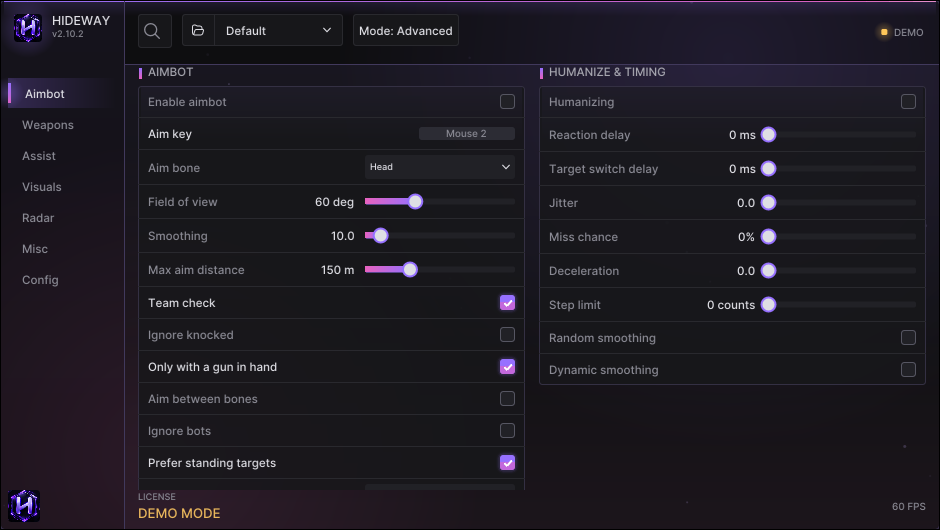

# Aimbot

The Aimbot page controls aim assist. It moves the mouse through your **input device**, so aim does nothing until a device is connected and verified ([Connect an input device](../guides/input-device.md)).

<figure><figcaption>
Aimbot page in Advanced mode: AIMBOT card on the left, HUMANIZE &#x26; TIMING on the right.
</figcaption></figure>

## AIMBOT card

| Option | What it does | Simple |
|---|---|---|
| **Enable aimbot** | Master switch for aim assist. Needs a connected, verified input device | yes |
| **Aim key** | Hold it to aim. Click the box, press a key or mouse button; click the box a second time to use Mouse 1; right-click to clear. Default: Mouse 2 | yes |
| **Aim bone** | Head, Neck, Chest, Pelvis or Closest bone | yes |
| **Field of view** | Only targets inside this cone around your crosshair count. Smaller = more selective | yes |
| **Smoothing** | How slowly the aim closes the gap. 1 = instant, higher = slower | yes |
| **Max aim distance** | Targets further than this are ignored | yes |
| **Team check** | Never aim at teammates | yes |
| **Ignore knocked** | Skip downed players | yes |
| **Only with a gun in hand** | Aim and trigger stay off while you hold a build piece, the pickaxe or an empty weapon | yes |
| Aim between bones | Aim at the closest point on the skeleton instead of one joint | |
| Ignore bots | Skip AI-controlled players | |
| Prefer standing targets | Standing players are chosen before downed ones | |
| Target priority | Closest to crosshair, or closest distance | |
| Lock until key release | Stay on the first target until you let go of the aim key | |
| Dead zone | Inside this angle the aim stops moving, so it does not shake | |

### Only with a gun in hand

With **Mouse 1** as your aim key, a click to place a wall would otherwise start the aim and lock onto an enemy behind it. With this option on (default), aim and trigger are off while the held item has no ammo: a build piece, the pickaxe, an empty weapon. If the game's weapon cannot be read, aim keeps working as before.


The "has ammo" rule was derived from a recorded match (pickaxe and build tool read 0 ammo almost all the time, firearms 1 to 30). If aim switches off wrongly for a weapon of yours, untick the option and report the weapon (the **Debug > LOCAL PLAYER** card shows its id and ammo).


## VISIBILITY card

| Option | What it does |
|---|---|
| **Visible only** | Only aim at targets the game is currently drawing (not behind walls) |
| Visibility check | How visibility is judged: render time, Unreal line of sight, or bones. See [Visibility](../guides/visibility.md) |
| Wait for wall check | With a ray-cast style, do nothing until the wall check has read the level (a few seconds into a match) |
| Visibility tolerance | How many ms a player counts as visible after the game drew them (default 200) |
| Submit-time visibility | Experimental: judge from the mesh's render timestamps instead |

Lines under the card say which method is active right now (for example "active: timestamps read as times").

## FOV CIRCLE, CALIBRATION, HUMANIZE & TIMING

* **FOV CIRCLE**: draw the aim cone and pick its colour; **Target line** draws a line to the current target.
* **CALIBRATION**: **Counts per degree X / Y**, the mouse counts that turn your view one degree. Tune them until the aim lands exactly on target. See [Tune aim and trigger](../guides/aim-and-trigger.md).
* **HUMANIZE & TIMING**: Reaction delay, Target switch delay, Jitter, Miss chance, Deceleration, Step limit, Random smoothing (min / max), Dynamic smoothing. These add variation to the movement; they are tuning controls, not a promise of anything.


Aim key and trigger key can be read from the **game PC's mouse** through the input device (**Read game-PC mouse buttons**, Misc), so the keys work from the mouse you are actually holding.

