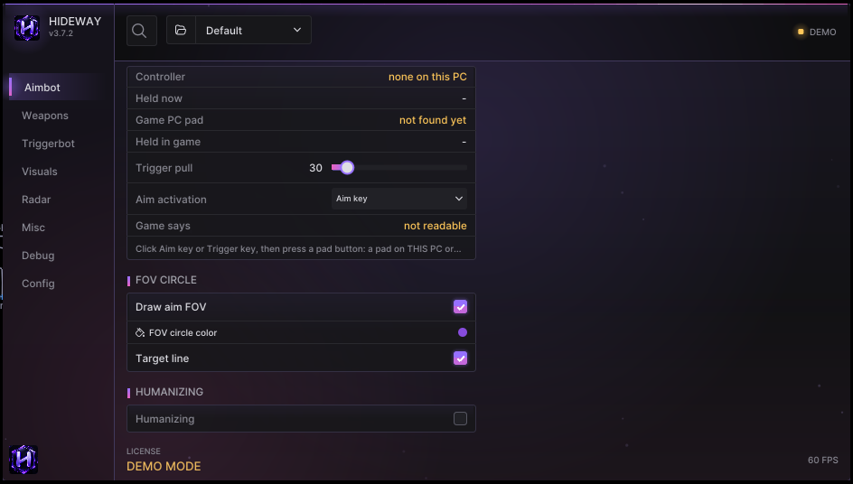

# Aimbot

This page controls aim assist, close aim, sticky aim and prediction. Aim assist moves your mouse through the **input device**, so it does nothing until a device is connected. See [Connect an input device](../guides/input-device.md). For a walk-through of the settings in a sensible order, read [Tune aim and trigger](../guides/aim-and-trigger.md).

<figure><figcaption>
The AIMBOT card on the left, close aim, sticky aim and prediction on the right.
</figcaption></figure>

<figure><figcaption>
Scrolled down: the rest of the AIMBOT card, the FOV circle and humanizing.
</figcaption></figure>

## Aimbot

| Option | What it does |
|---|---|
| Enable aimbot | Master switch. Needs a connected input device |
| Aim key | Hold it to aim. Click the box and press a key or mouse button; click it again to pick Mouse 1; right-click to clear. Default Mouse 2 |
| Read keys from the game PC | Also reads the keyboard and mouse of the game PC through the DMA card, so the aim key (and the trigger key) can be any key of the game PC's own keyboard. Off by default. The log (KEYS) says whether the key table of the game PC's Windows was found; if it reports many keys held at once it switches itself off for 5 minutes |
| Aim bone | Head, Neck, Chest or Pelvis aim at that part (the head a little above its joint, where the game counts a head hit). **Closest bone** aims at the point of the body nearest to your crosshair, between the joints. If the chosen part is behind a wall, the aim uses the nearest exposed part instead |
| Field of view | Only targets inside this cone around the crosshair count. Smaller is more selective |
| Smoothing | How slowly the aim closes the gap. 1 is instant. Each step adds about 8 ms to the time it takes to get there |
| Max aim distance | Targets further than this are ignored |
| Team check | Never aim at teammates |
| Ignore knocked | Skip downed players |
| Only with a gun in hand | Aim and trigger stay off while you hold a build piece, the pickaxe or an empty weapon |
| Aim between bones | Automatic (always on, not in the menu): makes **Closest bone** aim at the closest point of the skeleton to your crosshair, any bone segment (on the head it follows the crosshair up to 14 cm above the joint), and lets a chosen part that is behind a wall fall back to the nearest exposed one |
| Ignore bots | Skip bots |
| Prefer standing targets | Standing players are picked before downed ones |
| Target priority | Closest to the crosshair, or closest in distance |
| Lock until key release | Stay on the first target until you let go of the aim key |
| Dead zone | Inside this angle the aim stops moving, so it does not shake |

### Only with a gun in hand

If Mouse 1 is your aim key, clicking to place a wall would start the aim and lock onto whoever stands behind it. With this option on (the default), aim and trigger are off while the item in your hand has no ammo. If the game's weapon cannot be read, aim keeps working. If it switches off for a weapon that does shoot, untick the option and tell support which weapon it was: **Debug > LOCAL PLAYER** shows the weapon id and the ammo.

## Visibility

| Option | What it does |
|---|---|
| Visible only | Only aim at players the game is drawing, not the ones behind walls |
| Visibility check | How "visible" is decided: render time, Unreal line of sight, or bones. See [Visibility](../guides/visibility.md) |
| Wait for wall check | With a ray-cast style, do nothing until the level has been read, a few seconds into a match |
| Visibility tolerance | How many ms a player still counts as visible after the game drew them (default 200) |

The lines under the card say which method is active right now.

## Close aim, sticky aim, prediction

* **Close aim** uses its own field of view, smoothing and bone for enemies within a short range.
* **Sticky aim** keeps the aim attached once the crosshair is near a target: activation radius, max distance, smoothing, *slippery*, and *off vs groups*, which turns it off when several enemies are close.
* **Prediction** aims ahead of moving players: projectile speed and gravity (or **Per-weapon ballistics**), **Prediction lead** in milliseconds, **Hitscan weapon** to lead only, and a **Prediction dot** that shows where the aim expects the target.

## FOV circle, calibration, humanizing

* **FOV circle** draws the aim cone and lets you pick its colour. **Target line** draws a line to the current target.
* **Calibration** holds **Counts per degree X / Y**, the mouse counts that turn your view by one degree. The program measures them itself at start; change them only if the aim overshoots or falls short.
* **Humanizing and timing**: reaction delay, target switch delay, jitter, miss chance, deceleration, step limit, random smoothing and dynamic smoothing. They add variation to the movement.

The aim key and the trigger key can be read from the game PC's mouse through the input device (**Read game-PC mouse buttons** on Misc), so they work from the mouse you are really holding.
