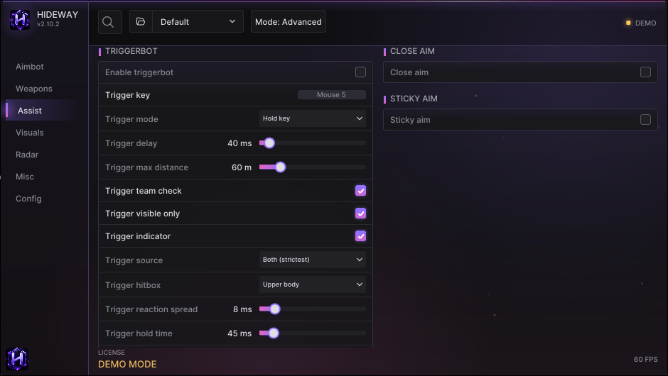

# Assist

Assist holds the helpers around aiming: the triggerbot, close aim, sticky aim and prediction. All of them need a connected input device.

<figure><figcaption>
The Assist page: TRIGGERBOT on the left, CLOSE AIM and STICKY AIM on the right.
</figcaption></figure>

## TRIGGERBOT

Fires while an enemy is under the crosshair.

| Option | What it does |
|---|---|
| **Enable triggerbot** | Master switch |
| **Trigger key** | Key for "Hold key" mode (default Mouse 5) |
| **Trigger mode** | *Hold key*: active only while the key is down. *Always on*. *Toggle key*: press once to arm, again to disarm |
| **Trigger delay** | Wait after an enemy is under the crosshair before firing |
| **Trigger reaction spread** | How much the reaction time varies around the delay |
| **Trigger hold time** | How long each shot is held |
| **Trigger max distance** | Do not fire at targets further than this |
| **Trigger team check / ignore knocked / ignore bots** | Who not to fire at |
| **Trigger visible only** | Only fire at a player the game drew, and whose hitbox point has nothing solid in front of it. Off = fires even through a wall |
| **Trigger indicator** | A ring at the crosshair: fills while the delay runs, turns green while the button is down |
| Trigger source | *Game target (UE5)*, *Crosshair geometry*, or *Both (strictest, default)* |
| Trigger hitbox | Which part must be under the crosshair |
| Trigger lead | Advance the target by its velocity × this many ms before the test |
| Trigger confirm frames | The same player must be a valid target for this many checks before the shot is armed |
| Trigger hold on target | Keep the button down on a valid target (full-auto), safety stop after 1.5 s |
| Trigger shotgun range | While a shotgun is held, never fire further than this |
| Trigger pause in menu | Never fire while the menu is open or panic is active |

The card shows a live **Last check** line (why it did or did not fire) when Advanced debug is on.


Like the aimbot, the trigger stays off while you hold something with no ammo (**Only with a gun in hand**, Aimbot page).


## CLOSE AIM

Uses a different field of view, smoothing and bone for enemies within a short range (**Close aim range**).

## STICKY AIM

Once the crosshair is near a target, the aim stays attached to it. Options: activation radius, max distance, smoothing, *slippery* (lets the aim slip a little), and *off vs groups* (turn sticky off when several enemies are close).

## PREDICTION

Leads moving targets for projectile weapons using their velocity: **Prediction**, **Projectile speed**, **Projectile gravity**, **Prediction lead** (extra ms along the velocity, also for hitscan weapons), **Hitscan weapon**, and a **Prediction dot** that shows where the aim expects the target.

## BALLISTICS PER WEAPON

**Per-weapon ballistics** switches projectile speed and gravity per class (pistol, rifle, SMG, shotgun, sniper). The defaults are tuned starting values. An unknown weapon class uses the single values.
