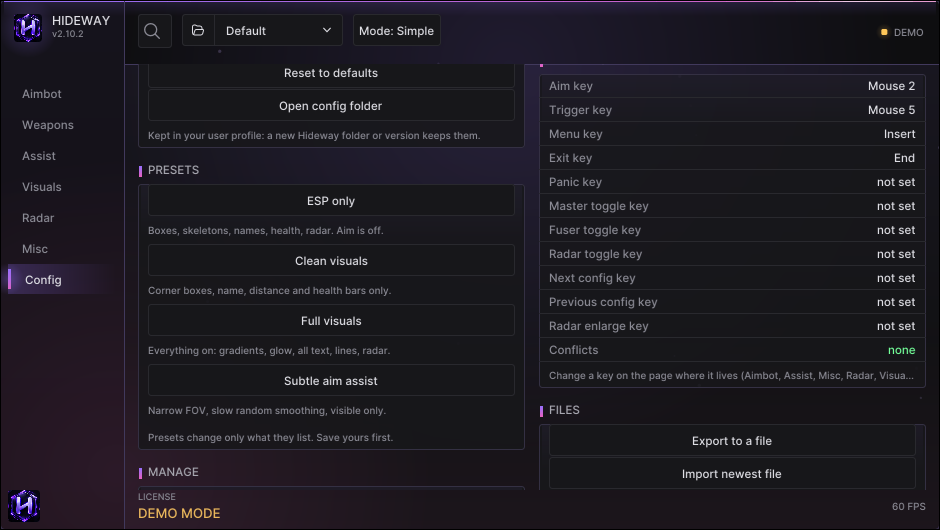
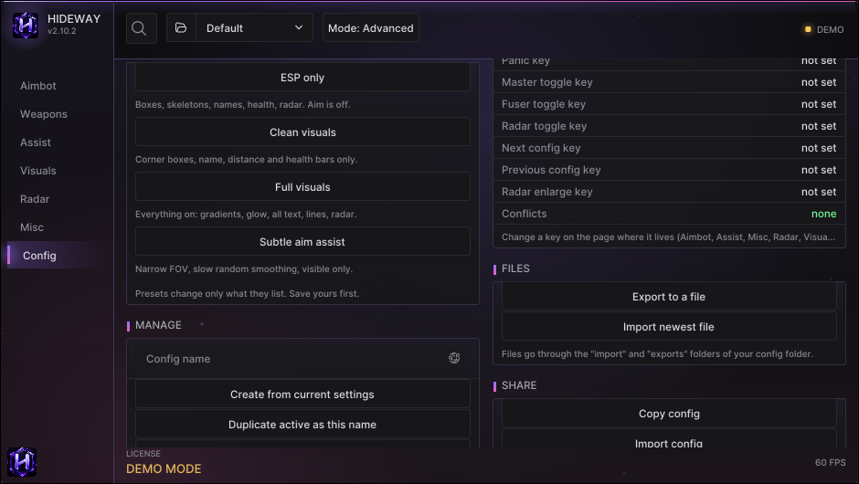
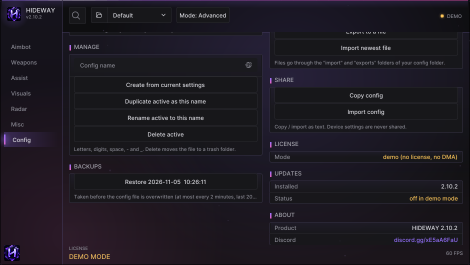

# Config

Everything about saving, sharing and housekeeping: configs, presets, backups, keybinds, files, license, updates and about.

<figure><figcaption><p>Config page: presets, keybinds, files and share cards.</p></figcaption></figure>

## Cards

| Card | What it does |
|---|---|
| **CONFIGS** | The list of configs; pick one to load. The active one is also in the top-bar dropdown |
| **CHANGES** | What differs from the saved file, for example `Auto-save config: on > off` |
| **PRESETS** | Four starting points: **ESP only**, **Clean visuals**, **Full visuals**, **Subtle aim assist**. A preset changes only the options it lists |
| **MANAGE** | Create from current settings, duplicate, rename, delete (goes to a trash), reset to defaults, open the config folder |
| **BACKUPS** | A copy of the config file is taken before every overwrite. Restore one here |
| **MENU STYLE** | 8 themes, accent colour, menu animations |
| **KEYBINDS** | Every key in one list, with a **Conflicts** line (should say *none*) |
| **FILES** | **Export to a file** / **Import newest file** (folders `exports` and `import` in the config folder) |
| **SHARE** | **Copy config** / **Import config** as text, for sharing |
| **LICENSE** | Mode and license state |
| **UPDATES** | Installed version and update status |
| **DEVICES** | Quick view of the input device |
| **ABOUT** | Product, version, support link |

<figure><figcaption><p>PRESETS with one-line descriptions.</p></figcaption></figure>

<figure><figcaption><p>MANAGE, BACKUPS, license, updates and about.</p></figcaption></figure>

## Where configs live

In your Windows profile, so a new Hideway folder, a reinstall or an update keeps them all:

```
%APPDATA%\Hideway\Fortnite\configs
```

Configs next to the program (older versions) are copied there once, never overwriting. In **demo mode**, or with a file named `portable.txt` beside `Hideway.exe`, configs stay next to the program instead.

## Safe sharing

Importing validates every line and ignores anything unknown, so a shared config cannot change anything outside the listed options. Settings that belong to **your machine** are never exported and never applied from shared text: input device and its address, port, Kmbox values, web radar and LAN, audio device.

See [Configs: presets, auto-save, backups](../guides/configs.md) for the workflow.
