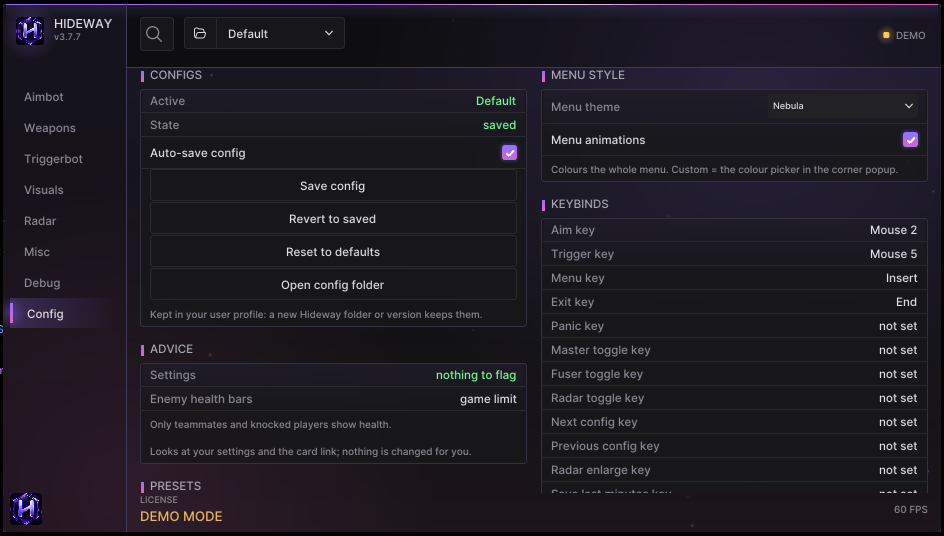
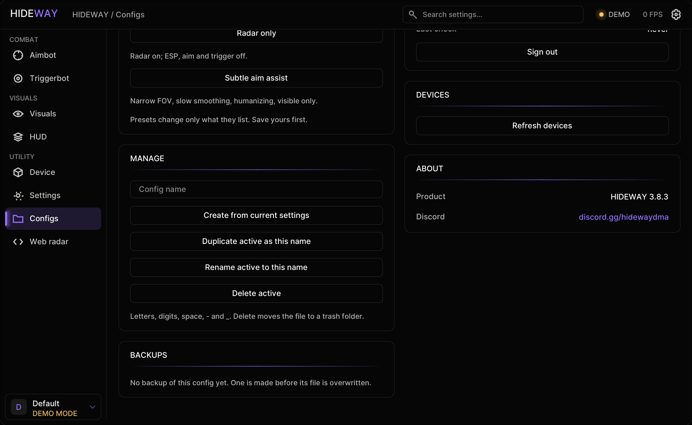

# Config

Everything about saving, sharing and housekeeping: configs, advice, presets, backups, keybinds, files, license and about.

<figure><figcaption><p>The Config page: configs, advice, menu style and keybinds.</p></figcaption></figure>

## Cards

| Card | What it does |
|---|---|
| **CONFIGS** | The active config (it is picked in the dropdown next to the search box), whether it is saved, **Auto-save config**, **Save config**, **Revert to saved**, **Undo** (what the last load, preset or import changed), **Reset to defaults** (asks twice) and **Open config folder** |
| **CHANGES** | What differs from the saved file, for example `Auto-save config: on > off` |
| **ADVICE** | The settings that are probably working against you, each with what it is now and the one thing to change (for example a Render distance under 200 m without Far markers, a single aim bone with a small field of view, a very low Smoothing, an aimbot or triggerbot that is on but has no key, an ESP with every part off). The same lines go to the log (**ADVICE**). It only looks; nothing is changed for you. With sensible settings it says *nothing to flag* |
| **PRESETS** | Five starting points: **ESP only**, **Clean visuals**, **Full visuals**, **Radar only**, **Subtle aim assist**. A preset changes only the options it lists |
| **MANAGE** | Create a config from the current settings, duplicate, rename, delete (the file goes to a trash folder) |
| **BACKUPS** | A copy of the config file is taken before every overwrite. Restore one here |
| **MENU STYLE** | 8 themes, accent colour, menu animations |
| **KEYBINDS** | Every key in one list, with a **Conflicts** line (should say *none*) |
| **FILES** | **Export to a file** / **Import newest file** (folders `exports` and `import` in the config folder) |
| **SHARE** | **Copy config** / **Import config** as text, for sharing |
| **LICENSE** | Plan, expiry, the account or the last digits of the key, the last check, **Sign out**. In demo mode: *demo (no license, no DMA)* |
| **DEVICES** | Only with a license that allows several PCs: how many activations are in use, which PCs, and **Remove** for the others (a KeyAuth license is locked to one PC and is reset in its dashboard) |
| **ABOUT** | Product, version, Discord |

Program updates are handled by the launcher (its Updates page), not here.

<figure><figcaption><p>Scrolled down: the end of PRESETS, MANAGE and BACKUPS on the left, SHARE, LICENSE and ABOUT on the right.</p></figcaption></figure>

## Where configs live

In your Windows profile, so a new Hideway folder, a reinstall or an update keeps them all:

```
%APPDATA%\Hideway\Fortnite\configs
```

Configs next to the program (older versions) are copied there once, never overwriting. In **demo mode**, or with a file named `portable.txt` beside `Hideway.exe`, configs stay next to the program instead.

## Safe sharing

Importing validates every line and ignores anything unknown, so a shared config cannot change anything outside the listed options. Settings that belong to **your machine** are never exported and never applied from shared text: input device and its address, port, Kmbox values, web radar and LAN, audio device.

See [Configs: presets, auto-save, backups](../guides/configs.md) for the workflow.
