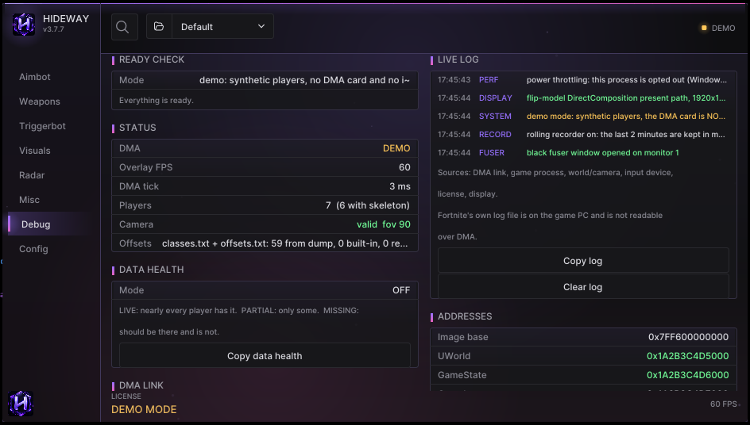
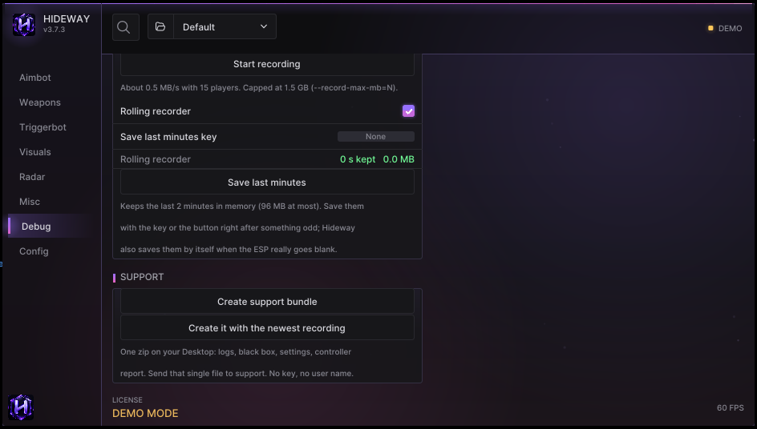

# Debug and Data health

The Debug page shows what Hideway is really getting from the game. It is **hidden by default**: turn it on with **Misc > Debug > Show debug page**.

<figure><figcaption>
The top of the Debug page in demo mode: READY CHECK, STATUS, DATA HEALTH and the LIVE LOG.
</figcaption></figure>

<figure><figcaption>
The bottom: RECORDING with the Rolling recorder, and SUPPORT.
</figcaption></figure>

## Cards

| Card | What it tells you |
|---|---|
| **READY CHECK** | The first thing to fix, in green / orange / red. See [READY CHECK](../getting-started/ready-check.md) |
| **STATUS** | DMA state, overlay FPS, offsets in use, last error |
| **DATA HEALTH** | One row per data source, with the share of players that have it. See below |
| **DMA LINK** | Disconnect / reconnect the card without closing Hideway (so you can re-plug it) |
| **OFFSET HEALTH** | Which offset group was proven by real data. **Copy diagnostics** copies a report; **Send report to support** sends it (with the black box) to the support service, and the answer shows in the launcher's Help page |
| **PERFORMANCE** | Frame time, spread, hitches, render thread cost, player-lane rate, card traffic, data age on screen |
| **LOCAL PLAYER** | Your held weapon (class and raw id), ammo, team, position, and **Teammates**: how many players share your team number and how many other squads are around. In a duo or squad, 0 with squads around (orange) means the team number is read wrong and teammates show as enemies |
| **LOOT READER** | What the loot reader found about the game's item layout |
| **REBOOT CARDS** | State of the reboot card reader |
| **TELEMETRY** | Measured prediction error, data age, visibility flips, aim and trigger counters |
| **AIM CALIBRATION** | Read-only: the mouse counts per degree the program measured itself (there is no setting for it) |
| **LATENCY** | Measure the mouse-to-camera delay and use it as Prediction / Trigger lead |
| **BLACK BOX** | The last minute of what the overlay had and drew, with the longest overlay frame of every half second (**frame(ms)**). Copy it or save it |
| **RECORDING** | A flight recorder for sharing a session with support. **Rolling recorder** keeps the last 2 minutes in memory and saves them afterwards (a key, a button, or by itself when the ESP really went blank) |
| **SUPPORT** | **Create support bundle**: one zip on your Desktop with the logs, the black box, your settings and the controller report. See [Collect diagnostics](../troubleshooting/collecting-diagnostics.md) |
| **LIVE LOG** | Real events with timestamps, with **Copy log** |
| **ADDRESSES**, **PLAYERS** | Raw addresses and the player list (Advanced debug and Player list on Misc) |

## DATA HEALTH

One table, one row per data source, with a state and the share of players that have it right now.

| State | Meaning |
|---|---|
| **LIVE** | Nearly every player (at least 90 %) has it |
| **PARTIAL** | Only some do. The row says which, for example *teammates only; no enemy value is sent* |
| **MISSING** | It should be there and is not |
| **WAITING** | Nothing to judge yet: lobby, loading screen, nobody in view |
| **OFF** | You turned the option off |

Rows: **Names**, **Team ID**, **Health / shield**, **Weapon**, **Skeleton**, **Visibility**, **Loot**, **Match counters**.


A lobby is *WAITING*, never *MISSING*: nothing is broken just because nobody is there. An option you turned off is *OFF*, not *MISSING*.


**Copy data health** copies the table as text. **Copy diagnostics** (in the OFFSET HEALTH card) includes it, plus versions, offset status, performance and the log. It never contains your license key.

## OFFSET HEALTH rows

Game process · World · Game state · Local player · Camera · Other players · Names · Skeletons · Health · Visibility clock. Each line is proven by data the reader actually returned, so after a game update the first red line points at what moved.

## LATENCY

**Measure latency** sends ten tiny mouse moves (net zero) and times how long the game camera takes to answer. Stand still in a match with your hands off the mouse. The result suggests a **Prediction lead** and **Trigger lead**, with buttons to use them.
