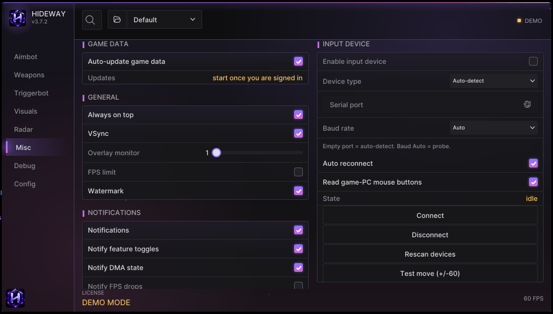
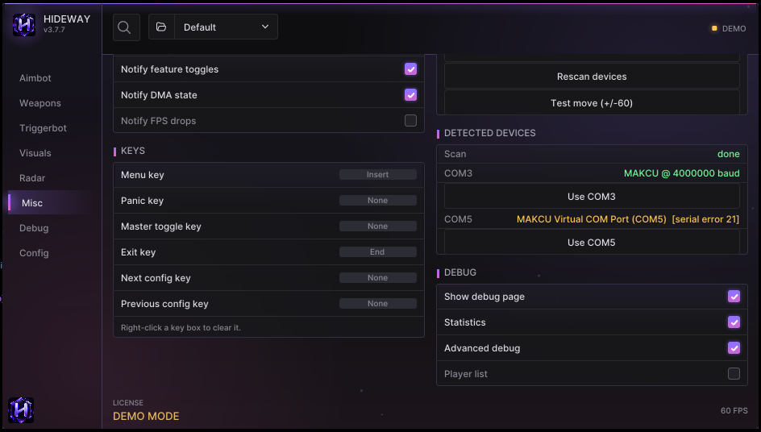

# Misc

System settings: game data, the overlay, notifications, keys, the input device and the debug switches.

<figure><figcaption>
The Misc page: game data, overlay settings, notifications and the INPUT DEVICE card.
</figcaption></figure>

## GAME DATA

**Auto-update game data**, the update status, the pack in use, **Check now**, **Install the update** and **Restore previous**. Only packs signed by Hideway are accepted; a new pack is installed automatically only if the game is not found with your files, and is undone by itself if the game still is not found with it. See [After a Fortnite update](../guides/after-a-fortnite-update.md).

## GENERAL

| Option | What it does |
|---|---|
| **Always on top** | Keep the overlay above other windows |
| **VSync** | Match the overlay to your display refresh rate |
| **Overlay monitor** | Which screen the overlay (and the fuser window) covers |
| **FPS limit / value** | Cap the overlay frame rate (use with VSync off) |
| **Watermark** | The small Hideway status badge |

## NOTIFICATIONS

Pop-up notices: master switch, feature toggles, DMA state, FPS drops, with an FPS threshold.

## KEYS

Menu key, Panic key, Master toggle key, Exit key, Next / Previous config key. See [Hotkeys](../guides/hotkeys.md).

## INPUT DEVICE and DETECTED DEVICES

Connect a MAKCU, Ferrum or KMBox NET so aim and trigger can move the mouse. **Read game-PC mouse buttons** lets the device report the game PC's mouse buttons, so aim and trigger keys work from the mouse in your hand. Full guide: [Connect an input device](../guides/input-device.md).

<figure><figcaption>
INPUT DEVICE buttons, DETECTED DEVICES, KEYS and DEBUG.
</figcaption></figure>

## DEBUG

| Option | What it does |
|---|---|
| **Show debug page** | Adds the Debug page to the side bar. Not needed for normal play |
| **Statistics** | Timing and counters on the Debug page |
| **Advanced debug** | Raw addresses and discovered offsets on the Debug page |
| **Player list** | The players Hideway currently reads, on the Debug page (shown once Advanced debug is on) |

## What is not here

The smoothing of the boxes (**Smooth ESP**, **ESP smoothness**, **Motion estimator**, **ESP time offset**) and the engine switches (**Fast DMA reads**, **High-rate camera lane**, **Thin skeleton reads**, **Fast position refresh**, **DMA stall guard**, **Wall check**) are decided by Hideway and are not in the menu: they are always set to the best value, and each one checks itself against live data. See [Automatic settings](../reference/options.md#automatic-settings-not-in-the-menu).

If the boxes still trail, lead or jitter, see [ESP looks wrong](../troubleshooting/esp-quality.md).
