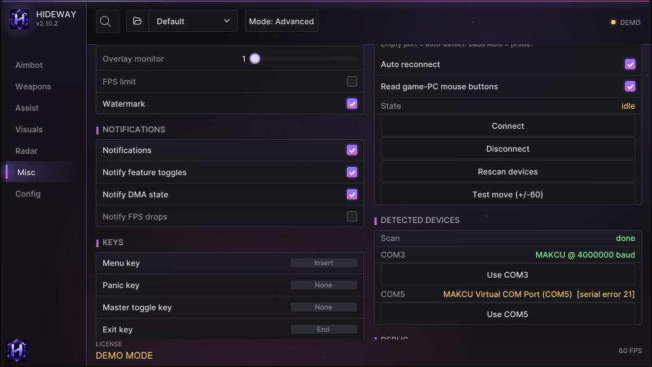
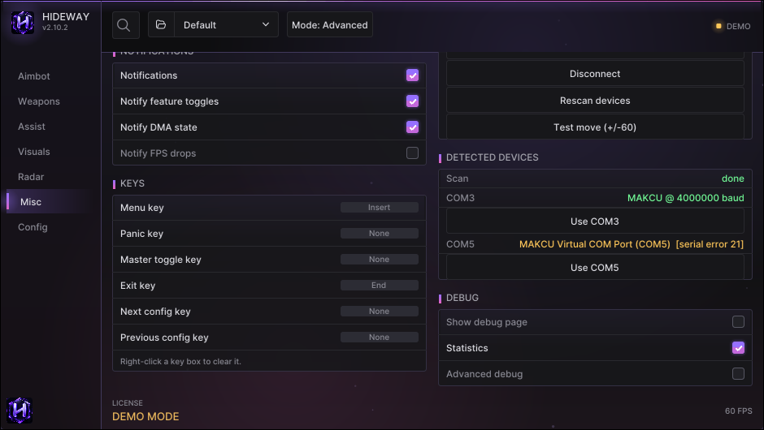

# Misc

System settings: the overlay, motion smoothing, keys, input device, debug switches and engine tuning.

<figure><figcaption>
The Misc page.
</figcaption></figure>

## GENERAL

| Option | What it does |
|---|---|
| **Always on top** | Keep the overlay above other windows |
| **VSync** | Match the overlay to your display refresh rate |
| **FPS limit / value** | Cap the overlay frame rate (use with VSync off) |
| **Overlay monitor** | Which screen the overlay (and the fuser window) covers |
| **Watermark** | The small Hideway status badge |
| **Smooth ESP** | Boxes and the camera glide between data updates instead of stepping |
| **ESP smoothness** | *Responsive* follows every reading at once; *Balanced* (default); *Silky* absorbs corrections more slowly (about a third less jitter in measured recordings, boxes sit a few cm further from raw readings). Needs Smooth ESP |
| **Smooth skeleton** | Anchors the skeleton on the pelvis and glides pose changes so limbs stop jittering |
| **Motion estimator** | One motion estimate per player shared by ESP, aim lead and trigger lead |
| **ESP time offset** | Raise it if boxes trail behind the game image, lower it if they lead. Default 0 |

## NOTIFICATIONS

Pop-up notices: master switch, feature toggles, DMA state, FPS drops, with an FPS threshold.

## KEYS

Menu key, Panic key, Master toggle key, Exit key, Next / Previous config key. See [Hotkeys](../guides/hotkeys.md).

## INPUT DEVICE and DETECTED DEVICES

Connect a MAKCU, Ferrum or KMBox NET so aim and trigger can move the mouse. Full guide: [Connect an input device](../guides/input-device.md).

<figure><figcaption>
INPUT DEVICE, DETECTED DEVICES and the KEYS card.
</figcaption></figure>

## DEBUG

| Option | What it does |
|---|---|
| **Show debug page** | Adds the Debug page to the side bar. Not needed for normal play |
| **Statistics** | Timing and counters on the Debug page |
| **Advanced debug** | Raw addresses and discovered offsets on the Debug page |
| **Player list** | The players Hideway currently reads, on the Debug page |

## ENGINE

| Option | What it does |
|---|---|
| **Fast DMA reads (scatter)** | Reads many values in one round trip. Hideway checks it against normal reads on live data and switches itself off if they disagree |
| **High-rate camera lane** | A dedicated thread reads the camera hundreds of times a second so boxes stay locked while you turn |
| **Fast position refresh** | In crowded matches, re-reads only where everybody is between two full reads |
| **Thin skeleton reads** | In crowded matches, distant and off-screen players do not get a skeleton read every tick |
| **DMA stall guard** | Pauses MemProcFS's background process refresh (a ~105 ms freeze every ~10 s on some setups) |
| **Read game-PC mouse buttons** | The input device reports the game PC's mouse buttons, so aim and trigger keys work from the mouse in your hand |
| **Wall check (ray-cast)** | Reads the level's collision geometry; needed by the wall-trace visibility styles and by loot |
| **Telemetry CSV** | One row per second of measured numbers to `telemetry.csv` |


These engine options are on by default where it matters and have self-checks. Turn one off only to compare, or if the Debug page tells you to.

