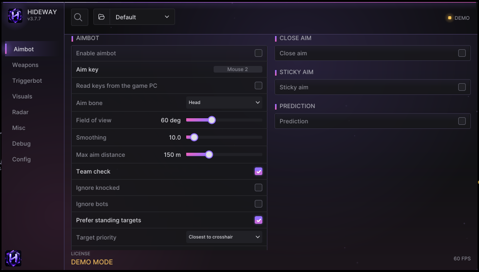

# The menu

Press **Insert** to open or close it. There is a side bar with the pages, a search box and the config dropdown on top, and the license state and frame rate at the bottom.

<figure><figcaption>
The Aimbot page in demo mode.
</figcaption></figure>

## The pages

Every page has two panels, left and right. The Aimbot and Triggerbot pages start with a row of weapon tabs, the Visuals page with a row of tabs (Players, Style, Colours, World).

| Page | What is on it | Explained in |
|---|---|---|
| Aimbot | Aim key, bone, field of view, smoothing, controller, humanizing, the targets, close aim, sticky aim, prediction; one tab per weapon class | [Aimbot](aimbot.md), [Weapons](weapons.md) |
| Triggerbot | When and how it fires, who it fires at; one tab per weapon class | [Triggerbot](triggerbot.md) |
| Visuals | Tabs: **Players** (the preview, what is drawn and for whom, the labels), **Style** (text, boxes, skeleton, head and bars, tracers, detail), **Colours** (player colour mode, every colour, fills and glow), **World** (loot and containers, reboot cards, spectators, audio alerts) | [Visuals](visuals.md) |
| HUD | Crosshair, match info, counters, the on-screen radar | [Visuals](visuals.md), [Radar](radar.md) |
| Device | The input device, detected devices, game data updates | [Misc](misc.md) |
| Settings | Overlay, notifications, keys, debug switches | [Misc](misc.md) |
| Configs | Configs, presets, backups, keybinds, sharing, license, updates | [Config](config.md) |
| Web radar | The web radar and the online link | [Radar](radar.md) |
| Debug | Hidden until you turn it on in Settings. Ready check, data health, performance, black box, recorder, support bundle | [Debug](debug.md) |

## One menu, no modes

There is no Simple / Advanced switch. Every setting you might want is on its page. Things that should simply work are automatic and are not shown: the gun-in-hand rule, aiming between bones, the visibility rule, the counts-per-degree calibration, the humanizing values, per-weapon ballistics, the trigger source, smooth ESP and the engine switches, label spacing, and the look of the radar. They are all listed under [Automatic settings](../reference/options.md#automatic-settings-not-in-the-menu).

## Search, tooltips and the config dropdown

* Click the magnifier and type. Matching options from every page are listed, and picking one takes you there.
* Hold the cursor on a row for half a second and a short explanation appears. Every option has one, and the same texts are in the [options reference](../reference/options.md).
* The folder icon and name next to the search box is your active config. Choosing another one switches to it, and the one you leave is saved first when Auto-save is on. See [Configs](../guides/configs.md).

## Menu style

**Configs > Menu style** has 8 themes, an accent colour for the Custom theme and a switch for the menu animations. Turn the animations off if you want a slightly lighter GPU load.

## The overlay and its keys

The menu sits on a transparent overlay that covers one monitor (**Settings > Overlay monitor**). With the menu closed you only see what you turned on: ESP, radar and HUD pieces.

| Key | What it does |
|---|---|
| Insert | Open or close the menu |
| End | Close Hideway |
| Panic key (not set by default) | Hide everything and stop reading the game until you press it again |
| Master toggle key (not set by default) | Switch every feature on or off without closing the menu |

All keys can be changed. See [Hotkeys](../guides/hotkeys.md).
