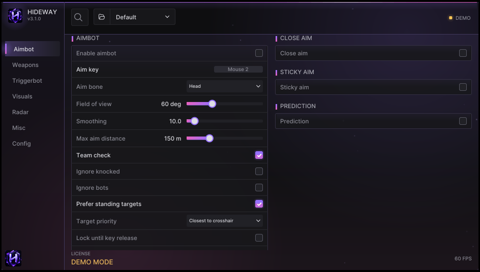

# Menu overview

Press **Insert** (default) to open or close the menu. It has a left side bar with the pages, a top bar with search and the config dropdown, and a bottom bar with the license state and frame rate.

<figure><figcaption>
The Aimbot page. Side bar on the left; search and config dropdown on top.
</figcaption></figure>

## The pages

| Page | What is on it |
|---|---|
| [**Aimbot**](aimbot.md) | Aim key, bone, field of view, smoothing, visibility rules, humanizing, calibration |
| [**Weapons**](weapons.md) | Per-class overrides (rifle, pistol, SMG, shotgun, sniper) and weapon detection |
| [**Assist**](assist.md) | Triggerbot, close aim, sticky aim, prediction, ballistics per weapon |
| [**Visuals**](visuals.md) | Everything drawn on players, loot, reboot cards, spectators, audio alerts, colours |
| [**Radar**](radar.md) | On-screen radar and the web radar |
| [**Misc**](misc.md) | Overlay settings, notifications, keys, input device, debug switches, engine |
| [**Config**](config.md) | Configs, presets, backups, keybinds, files, sharing, license, updates, about |
| [**Debug**](debug.md) | Hidden by default. Ready check, data health, performance, log. Turn it on in Misc |

## One menu, everything in it

The menu is **all-in-one**: every setting is on its page, nothing is hidden and there is no mode to switch. Older versions had a **Simple / Advanced** Mode button; it is gone.


**Looking for an option?** Type its name in the search box: it lists the matching options from every page and takes you straight there.


## Search

Click the magnifier in the top bar and type. It lists matching options from every page; choosing one takes you there.

## The config dropdown

The folder icon and name next to the search box is the **active config**. Pick another config to switch to it. The one you leave is saved first when Auto-save is on. See [Configs](../guides/configs.md).

## Tooltips

Rest the cursor on a row for about half a second: a short explanation appears. Every option has one; the same texts are in the [Options reference](../reference/options.md).

## Menu style

**Config > Menu style** has 8 themes, an accent colour for the Custom theme, and **Menu animations** (slow aurora, floating lights, shimmer). Turn animations off for a slightly lighter GPU load.

## The overlay itself

The menu is drawn on top of a transparent overlay that covers one monitor (**Misc > Overlay monitor**). When the menu is closed you only see the ESP, radar and HUD pieces you enabled.

| Key | Action |
|---|---|
| **Insert** | Open / close the menu |
| **End** | Exit Hideway |
| **Panic key** (not set by default) | Hide everything and stop reading the game until pressed again |
| **Master toggle key** (not set by default) | Turn all cheat features on / off without closing the menu |

All keys are rebindable; see [Hotkeys](../guides/hotkeys.md).
