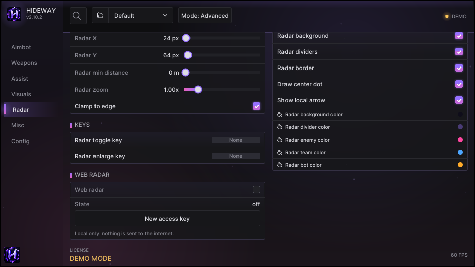

# Radar

Two radars: a small one drawn on the overlay, and a **web radar** you can open on a phone, tablet or second monitor.

<figure><figcaption>
The Radar page.
</figcaption></figure>

## RADAR card

| Option | What it does |
|---|---|
| **Enable radar** | Show the radar on screen |
| **Radar shape** | Square or circle |
| **Radar size** | Size in pixels |
| **Radar range** | How far (metres) the radar reaches |
| **Radar zoom** | Zoom multiplier |
| **Rotate with view** | The radar turns with your camera so "up" is forward. Off: north stays up and your arrow turns |
| **Clamp to edge** | Players beyond the range are pinned to the edge instead of disappearing |
| Radar X / Y | Position on the screen |
| Radar min distance | Hide players closer than this (they are already on screen) |
| Show local arrow | The arrow that shows where you look |
| Radar dividers | A cross and three range rings (1/3, 2/3, full) with their distances |

## FILTERS and STYLE

Choose who is shown (bots, knocked players, teammates, distance text) and the colours: background, border, dividers, enemy, team, bot.

## KEYS

**Radar toggle key** shows / hides the radar. **Radar enlarge key** makes it bigger while toggled.

## WEB RADAR

Your radar in a browser. Full guide: [Web radar on your phone](../guides/web-radar.md).

| Option | What it does |
|---|---|
| **Web radar** | Starts a small web server inside Hideway. Off by default |
| **Allow other devices (LAN)** | On: phones and other PCs on your network can open it. Off (default): only this PC |
| **Web radar port** | TCP port of the page |
| **Web radar rate** | Update interval. 50 ms = 20 updates per second |
| **Web radar names** | Off: names are not sent to the page at all |
| **Copy radar link** | Copies the link, which contains your access key |
| **New access key** | Old links stop working |


Nothing goes to the internet. There is no cloud and no account; the page is served from your PC.

