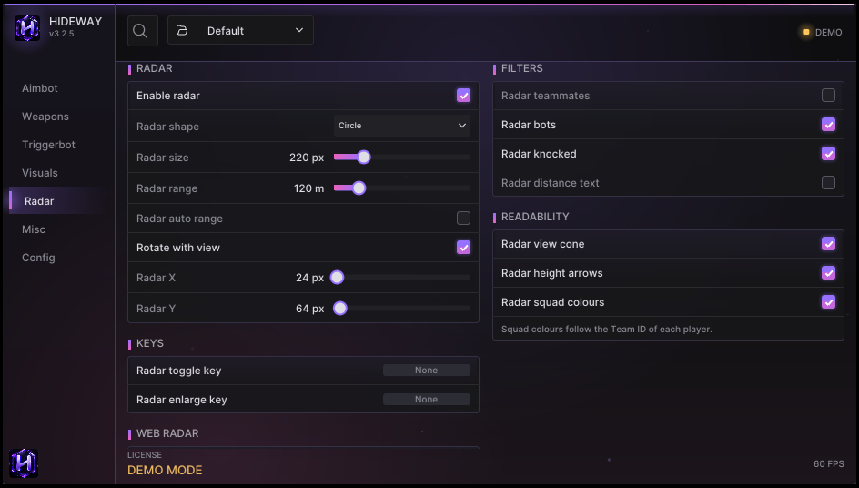
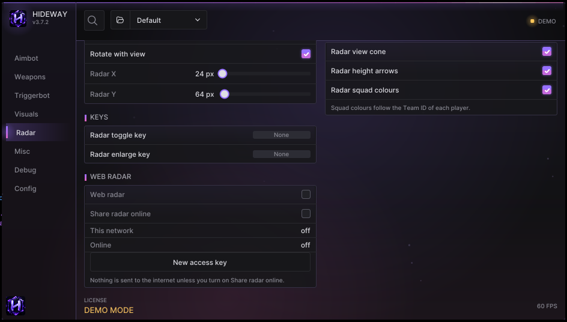

# Radar

*Since 3.8.0 the on-screen radar cards (RADAR, KEYS, FILTERS, READABILITY) are on the **HUD** page, and the WEB RADAR card has its own **Web radar** page.*

Two radars: a small one drawn on the overlay, and a **web radar** you can open on a phone, tablet or second monitor.

<figure><figcaption>
The Radar page: the on-screen radar, filters and readability on the right.
</figcaption></figure>

<figure><figcaption>
Scrolled down: the radar keys and the WEB RADAR card.
</figcaption></figure>

## RADAR card

| Option | What it does |
|---|---|
| **Enable radar** | Show the radar on screen |
| **Radar shape** | Square or circle |
| **Radar size** | Size in pixels |
| **Radar range** | How far (metres) the radar reaches |
| **Radar auto range** | The range follows the nearest enemies |
| **Rotate with view** | The radar turns with your camera so "up" is forward. Off: north stays up and your arrow turns |
| Radar X / Y | Position on the screen |

The look of the radar is automatic and not in the menu: players beyond the range are pinned to the edge instead of disappearing, a cross and three range rings (1/3, 2/3, full) with their distances, the arrow that shows where you look, the dark panel and border, the colours, a short tick on a dot showing which way that player runs and an N where north is. See [Automatic settings](../reference/options.md#automatic-settings-not-in-the-menu).

## FILTERS and READABILITY

Choose who is shown (teammates, bots, knocked players) and whether the distance is written next to each dot. **Radar view cone** draws your field of view, **Radar height arrows** put a small arrow above a dot when that player is higher than you (below it when lower), and **Radar squad colours** colour the dots by Team ID.

## KEYS

**Radar toggle key** shows / hides the radar. **Radar enlarge key** makes it bigger while toggled.

## WEB RADAR

Your radar in a browser. Full guide: [Web radar on your phone](../guides/web-radar.md).

| Option | What it does |
|---|---|
| **Web radar** | Starts a small web server inside Hideway. Off by default |
| **Allow other devices (LAN)** | On: phones and other PCs on your network can open it. Off (default): only this PC |
| **Share radar online** | Off by default. On: the radar is also pushed to the Hideway radar relay so a friend on any network can open it with the online link |
| **Copy local link** / **Copy online link** | Copy the link, which contains an access key |
| **New access key** / **New online link** | Old links stop working |

The port (8765), the update rate (20 per second) and whether names are sent are automatic and not in the menu.


The local web radar is served from your PC: no cloud, no account. Nothing goes to the internet unless you turn on **Share radar online**, see [Web radar](../guides/web-radar.md) and [Security and privacy](../reference/security-and-privacy.md).

