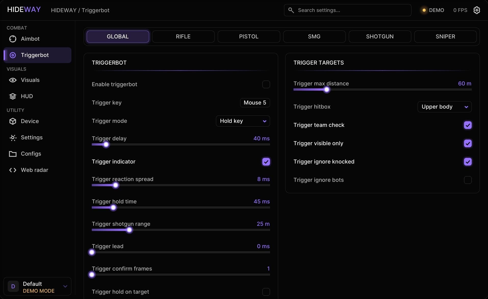
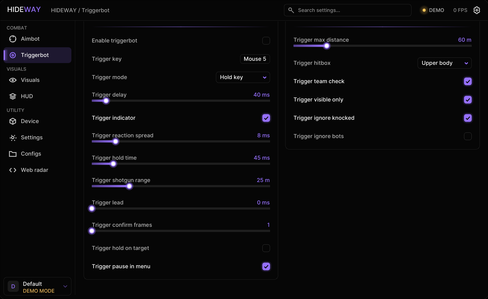

# Triggerbot

*Since 3.8.0 the page has the TRIGGERBOT card (key, mode, timing) on the left and TRIGGER TARGETS (distance, hitbox and who it ignores) on the right, under the weapon tabs.*

The triggerbot fires while an enemy is under your crosshair. It needs a connected input device. Close aim, sticky aim and prediction are on the [Aimbot page](aimbot.md).

<figure><figcaption>
Key, mode, delay and timing on the left, distance, hitbox and who it ignores on the right.
</figcaption></figure>

<figure><figcaption>
Scrolled down: the rest of the TRIGGERBOT card.
</figcaption></figure>

| Option | What it does |
|---|---|
| Enable triggerbot | Master switch |
| Trigger key | The key for *Hold key* mode. Default Mouse 5 |
| Trigger mode | *Hold key*: active only while the key is down. *Always on*. *Toggle key*: press once to arm, again to disarm |
| Trigger delay | How long to wait after an enemy is under the crosshair before firing |
| Trigger reaction spread | How much that wait varies |
| Trigger hold time | How long each shot is held |
| Trigger max distance | Do not fire at targets further than this |
| Team check, ignore knocked, ignore bots | Who not to fire at |
| Trigger visible only | Only fire at a player the game drew, with nothing solid in front of the hitbox point. Off means it fires through walls |
| Trigger indicator | A ring at the crosshair: it fills while the delay runs and turns green while the button is down |
| Trigger hitbox | Which part has to be under the crosshair |
| Trigger lead | Move the target ahead by its velocity times this many ms before the test |
| Trigger confirm frames | The same player must be a valid target for this many checks before the shot is armed |
| Trigger hold on target | Keep the button down while the target stays valid (full-auto). It stops after 1.5 s |
| Trigger shotgun range | While a shotgun is in hand, never fire further than this |
| Trigger pause in menu | Never fire while the menu is open or panic is active |

The **trigger source** is automatic (not in the menu) and always the strictest: the game's own crosshair trace and Hideway's hitbox test have to agree. If the game's target cannot be read, the trigger falls back to the hitbox test. With **Misc > Advanced debug** on, this page also shows the **Deciding source** and the **Last check**, the reason the trigger did or did not fire.

Like the aimbot, the trigger stays off while you hold something without ammo (**Only with a gun in hand**, automatic).
