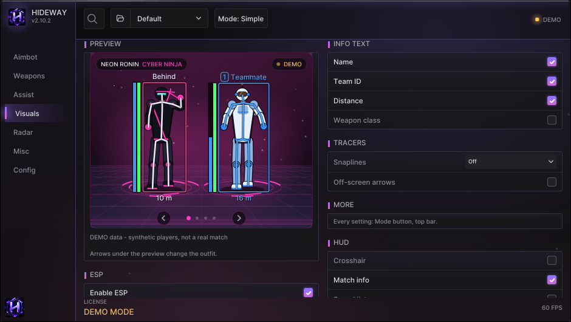
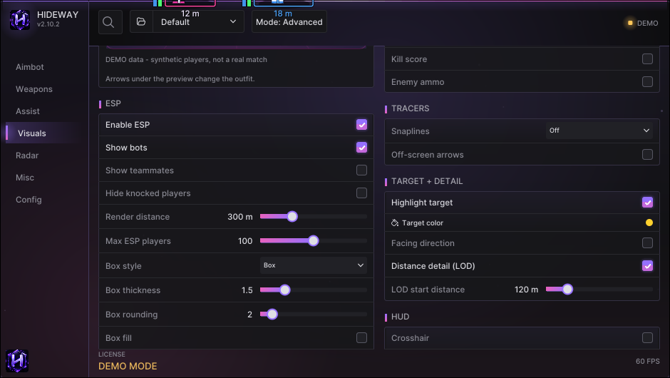
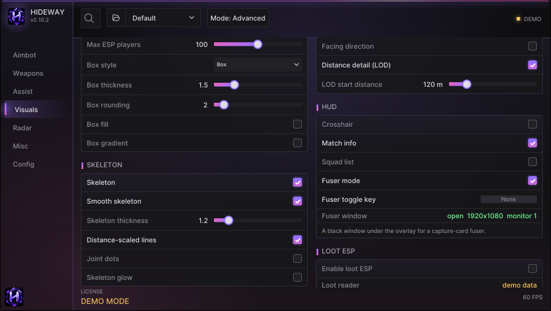

# Visuals

Everything Hideway draws on players and in the world. The page opens on a **PREVIEW** card that shows your current style on sample players.

<figure><figcaption>
The Visuals page. The PREVIEW card shows demo data (labelled) so you can see what a toggle changes. The arrows under it change the outfit.
</figcaption></figure>

## Cards

| Card | What is in it |
|---|---|
| **PREVIEW** | Your style on sample players. Always marked DEMO: synthetic, not a real match |
| **ESP** | **Enable ESP** (master), Show bots, Show teammates, Hide knocked players, Render distance, Max ESP players, Box style (Off / Box / Corners / 3D box), thickness, rounding, fill, gradient |
| **SKELETON** | Skeleton, thickness, distance-scaled lines, joint dots, glow, **Smooth skeleton** |
| **HEAD & BARS** | Head circle; **Health + shield bars**, Health numbers, Bar style (Classic / Segmented), Bar side, Damage trail |
| **INFO TEXT** | Name, **Team ID**, Distance, Weapon class, Platform, Kill score, Enemy ammo, Squad list |
| **TRACERS** | Snaplines, off-screen arrows |
| **TARGET + DETAIL** | Highlight target (the player the aim or trigger picked), Distance detail (LOD) |
| **MORE / HUD** | Crosshair, **Match info**, Fuser mode, Facing direction, Fade in players, Avoid overlapping labels |
| **LOOT ESP** | Items on the ground. See [Loot, containers and reboot cards](../guides/loot-and-world.md) |
| **REBOOT CARDS** | Marks reboot cards of dead players |
| **SPECTATORS** | Who is spectating you |
| **AUDIO ALERTS** | Generated positional tones when an enemy comes in range |
| **COLORS** | Every colour used above |

<figure><figcaption>
The ESP card with every box and skeleton option.
</figcaption></figure>

## Team ID

A small number before the name: the **game's own team number**. Everyone in the same duo / trio / squad carries the same number. **Team ID only for squads** hides it when nobody else has it (solo play), and **Team ID colours** gives every team its own colour.

## Health and shield bars

Bars next to the box, read from the game. Read the rules on [Health and shield bars](../troubleshooting/health-and-data.md): the game does not always send enemy health, and Hideway shows **no bar** rather than an invented one.

* **Bar style**: Classic, or Segmented (split in four so 25 / 50 / 75 % are easy to read).
* **Damage trail**: the lost part of a bar drains down slowly so you can see how big a hit was.
* **Low health highlight**: a pulsing red outline on an enemy under the threshold (only when a real health value was read).

## Squad list and match info

* **Squad list**: a panel at the top right with every other squad in range: team number, members alive (and down), distance of the nearest one.
* **Match info**: players left and teams left at the top of the screen, as the game counts them. Hidden when the game gives no sensible numbers (lobby).

## Smooth ESP lives on Misc

How smooth the boxes move is set on the **Misc** page (Smooth ESP, ESP smoothness, Smooth skeleton, Motion estimator). See [Set up the ESP](../guides/esp-setup.md).

<figure><figcaption>
Lower half: skeleton, head, HUD, loot.
</figcaption></figure>
