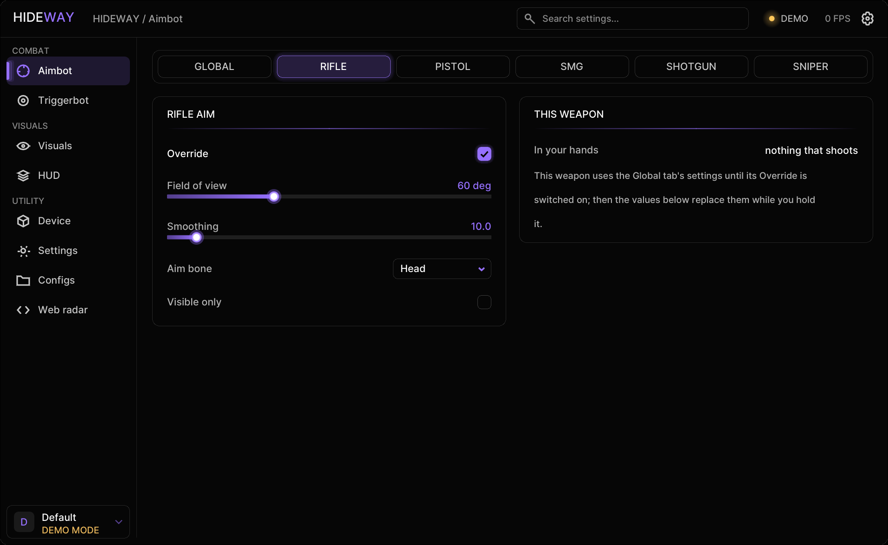

# Weapons

*Since 3.8.0 there is no Weapons page: each weapon class is a tab at the top of the **Aimbot** page (its aim override) and of the **Triggerbot** page (its trigger switch and delay). A dot on a tab means that class is in your hands right now and its override is on. The text below explains the settings.*

The Weapons page lets each class of weapon use its own aim settings.

<figure><figcaption>
One override card per weapon class: Rifle, Pistol, SMG, Shotgun, Sniper.
</figcaption></figure>

## Per-class overrides

Cards: **RIFLE**, **PISTOL**, **SMG**, **SHOTGUN**, **SNIPER**. Each has an **Override** switch. When it is on, that class uses its own **Field of view**, **Smoothing**, **Aim bone**, **Visible only**, **Trigger on** (the triggerbot fires with this class or stays quiet) and **Trigger delay** instead of the general Aimbot and Triggerbot values. When it is off, the class follows the Aimbot page.

Use it, for example, to give shotguns a wide, fast aim at short range and snipers a narrow, slow one.

## How the class is found

Hideway reads the held weapon's **animation id** from the game and maps it to a class (the ids are not in the menu: they are automatic). On the Debug page, **LOCAL PLAYER** shows the class and the raw id of the weapon you hold right now, for example `Rifle (id 4)`. Recorded matches confirmed the pistol, shotgun and rifle ids; the others are defaults. If it says `Other` for a weapon you hold, send the id it shows to support, see [Aim or trigger problems](../troubleshooting/aim-and-trigger.md).

## Ballistics

Projectile speed and gravity are not in the menu either: prediction takes them live from the weapon in your hand, with a tuned value per weapon class as the fallback. See [Automatic settings](../reference/options.md#automatic-settings-not-in-the-menu).
