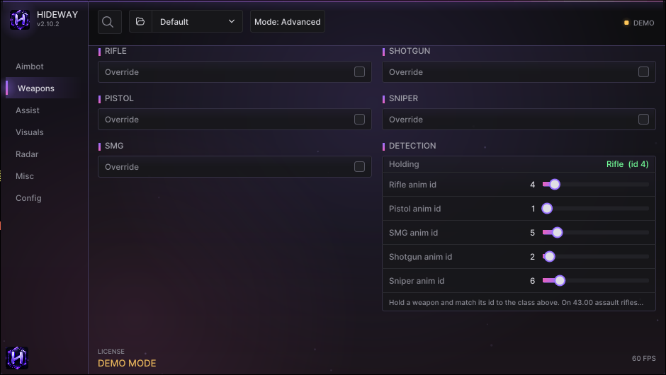

# Weapons

The Weapons page lets each class of weapon use its own aim settings, and shows how Hideway recognises the weapon you hold.

<figure><figcaption>
Per-class overrides on the left, DETECTION on the right.
</figcaption></figure>

## Per-class overrides

Cards: **RIFLE**, **PISTOL**, **SMG**, **SHOTGUN**, **SNIPER**. Each has an **Override** switch. When it is on, that class uses its own field of view, smoothing, bone and visibility rule instead of the general Aimbot values. When it is off, the class follows the Aimbot page.

Use it, for example, to give shotguns a wide, fast aim at short range and snipers a narrow, slow one.

## DETECTION card

Hideway reads the held weapon's **animation id** from the game and maps it to a class.

| Row | Meaning |
|---|---|
| **Holding** | The class and raw id of the weapon you hold right now, for example `Rifle (id 4)` |
| **Rifle / Pistol / SMG / Shotgun / Sniper anim id** | The id that means that class |


The id table is only partly known on Fortnite 43.00. Recorded matches confirmed pistol, shotgun and rifle ids; the rest are defaults. If the card shows `Other` for a weapon you hold, note the id it shows and set the matching class id here. See [Aim or trigger problems](../troubleshooting/aim-and-trigger.md).


## Per-weapon ballistics

Projectile speed and gravity per class (used by prediction) are on the **Aimbot** page (PREDICTION card) under **BALLISTICS PER WEAPON**.
